<a name="top"></a>

> [!NOTE]
> *해당 문서는 초안으로 확정된 것이 아닙니다! README 문서 틀만 잡아 놓은 것으로,*<br>
> *정확한 내용(담당, 패키지 구조 내용 등)은 프로젝트 완성 후 최종 수정 예정입니다.*

<div align="center">

[](https://github.com/SB14-HJ3S/sb14-monew-team03/actions/workflows/ci.yml?query=branch%3Adevelop)
[](https://app.codecov.io/gh/SB14-HJ3S/sb14-monew-team03/tree/develop)

<!-- develop의 CI 실행 완료 후 갱신. 청록: 성공 또는 커버리지 80% 이상, 밝은 분홍: 실패 또는 80% 미만, 연한 회색: 취소 또는 결과 없음. -->

<a href="https://monew.is-a.dev/">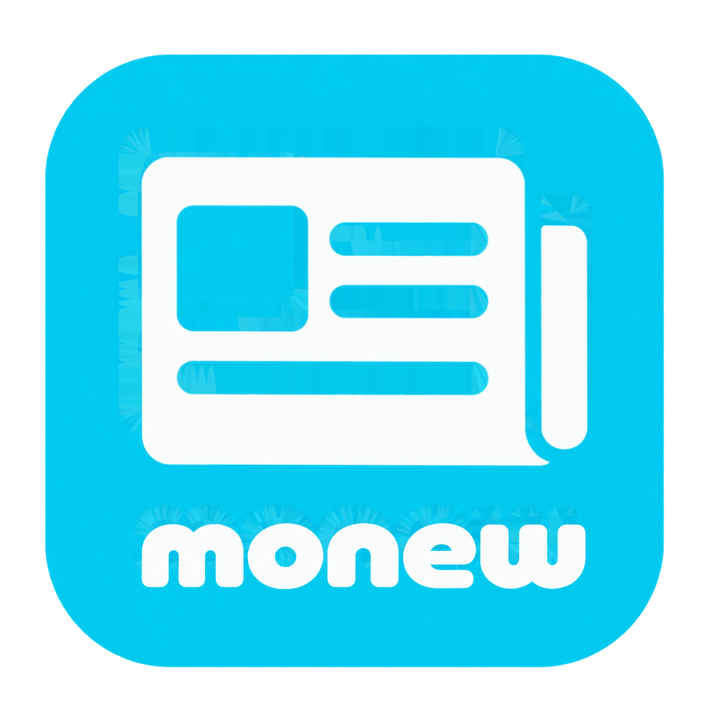</a>

<table align="center">
<tr>
  <td align="left"><b>모뉴 기간</b></td>
  <td align="left">2026.10.20 ~ 2026.11.10</td>
</tr>
<tr>
  <td align="left" valign="top"><b>모뉴 설명</b></td>
  <td align="left">넘쳐나는 뉴스 속에서 <b>'나에게 맞는 뉴스'</b>만 보고 싶은 사용자를 위해,<br>관심사에 맞춰 뉴스를 자동으로 수집하고 댓글 · 좋아요 · 알림으로 <br><b>함께 이야기하는 개인화 뉴스 플랫폼 📰 </b>입니다.</td>
</tr>
<tr>
  <td align="left" valign="top"><b>핵심 목표</b></td>
  <td align="left">· 관심사 기반 뉴스 큐레이션 및 자동 수집<br>· 사용자 활동(댓글, 좋아요, 알림) 통합 관리<br>· 스케줄러 기반 기사 동기화 및 S3 백업 · 복구 기능<br>· Actuator 기반 모니터링으로 운영 관찰성 확보</td>
</tr>
<tr>
  <td align="left"><b>관련 링크</b></td>
  <td align="left"><a href="https://monew.is-a.dev/">🌐 배포 링크</a> &nbsp;|&nbsp; <a href="https://monew.is-a.dev/swagger-ui/index.html">📑 API 문서</a> &nbsp;|&nbsp; <a href="https://github.com/SB14-HJ3S/sb14-monew-team03">💻 GitHub</a> &nbsp;|&nbsp; <a href="https://app.notion.com/p/SB14-Monew-Team03-7589e310974382c2a2e001fa888a5a22">📝 Notion</a> &nbsp;|&nbsp; <a href="https://github.com/orgs/SB14-HJ3S/projects/3">📆 Git Projects</a></td>
</tr>
</table>

<sub>※ 배포 데모 접속 링크는 <b>2026년 11월 17일 23시 59분</b>까지 운영되며, 이후에는 접속이 종료됩니다.</sub>

</div>

---

<p align="center">
  
</p>

## 📌 현.재.삼.수 멤버 5인 소개 (임시)

<table align="center">
<tr>
  <td align="center" width="180">
    <a href="https://github.com/mjdevkim"></a><br/>
    <a href="https://github.com/mjdevkim"></a>
  </td>
  <td align="center" width="180">
    <a href="https://github.com/ssoomni52"></a><br/>
    <a href="https://github.com/ssoomni52"></a>
  </td>
  <td align="center" width="180">
    <a href="https://github.com/Hanna-log"></a><br/>
    <a href="https://github.com/Hanna-log"></a>
  </td>
  <td align="center" width="180">
    <a href="https://github.com/lsc0869"></a><br/>
    <a href="https://github.com/lsc0869"></a>
  </td>
  <td align="center" width="180">
    <a href="https://github.com/swanhw"></a><br/>
    <a href="https://github.com/swanhw"></a>
  </td>
</tr>
<tr>
  <td align="center"><a href="https://app.notion.com/p/8649e310974383be8106818c94ed3a14">📝 개발 리포트</a></td>
  <td align="center"><a href="https://app.notion.com/p/c679e3109743836c8b7281289df7403a">📝 개발 리포트</a></td>
  <td align="center"><a href="https://app.notion.com/p/8609e3109743824d88e18146d3653ede">📝 개발 리포트</a></td>
  <td align="center"><a href="https://app.notion.com/p/3309e3109743836895860154ffeca8ca">📝 개발 리포트</a></td>
  <td align="center"><a href="https://app.notion.com/p/a5d9e310974383f1962e812f40211f0f">📝 개발 리포트</a></td>
</tr>
<tr>
  <td align="center" valign="top"><b>김민재</b><br/>기술팀장<br/><br/><sub><i>(예시 작성)</i><br/>· 뉴스 기사 수집 배치<br/>· 기사 백업 · 복구<br/>· 기사 목록 조회</sub></td>
  <td align="center" valign="top"><b>박수민</b><br/>기술부팀장<br/><br/><sub><i>(예시 작성)</i><br/>· 배치 공통 틀 설계<br/>· 관심사 CRUD<br/>· 관심사 구독 · 구독자 수 집계</sub></td>
  <td align="center" valign="top"><b>이승현</b><br/>행정팀장<br/><br/><sub><i>(예시 작성)</i><br/>· 사용자 회원가입<br/>· 로그인<br/>· 물리 삭제<br/>· 논리 삭제 구현</sub></td>
  <td align="center" valign="top"><b>이수찬</b><br/>팀원<br/><br/><sub><i>(예시 작성)</i><br/>· 활동 내역 조회<br/>· 알림 생성 · 확인 처리<br/>· 오래된 알림 자동 삭제</sub></td>
  <td align="center" valign="top"><b>정수환</b><br/>팀원<br/><br/><sub><i>(예시 작성)</i><br/>· 댓글 CRUD<br/>· 댓글 좋아요<br/>· 커서 페이지네이션</sub></td>
</tr>
</table>

---

## 📌 개발 일정 (임시)

> 🧪 *세부 일정은 팀 회의 후 확정 예정입니다. 현재는 단계 구분만 잡아 둔 상태입니다.*

| 단계 | 기간 | 주요 작업 |
|:---|:---|:---|
| **기획 · 설계** | `10.20 ~ (미정)` | 요구사항 분석, ERD · API 명세 정리, 역할 분담 |
| **공통 기반** | `(미정)` | 프로젝트 초기 세팅, 공통 예외 · 응답 포맷, CI 구성 |
| **1차 개발** | `(미정)` | 도메인별 핵심 기능 구현 (사용자 · 관심사 · 뉴스 · 댓글 · 알림) |
| **중간 점검** | `(미정)` | 기능 시연 및 피드백 반영 |
| **2차 개발** | `(미정)` | 배치 · 백업 · 모니터링 등 심화 기능, 리팩토링 |
| **배포** | `(미정)` | AWS 배포 및 배포 자동화 |
| **마무리 · 발표** | `(미정) ~ 11.10` | 테스트 보강, 문서화, 최종 발표 |

---

## 📌 서비스 화면 (임시 : 코드잇 제공 프로토타입 기준 -> 프로젝트 완성 후 변경 예정)

<table>
<tr>
  <td align="center" width="50%">
    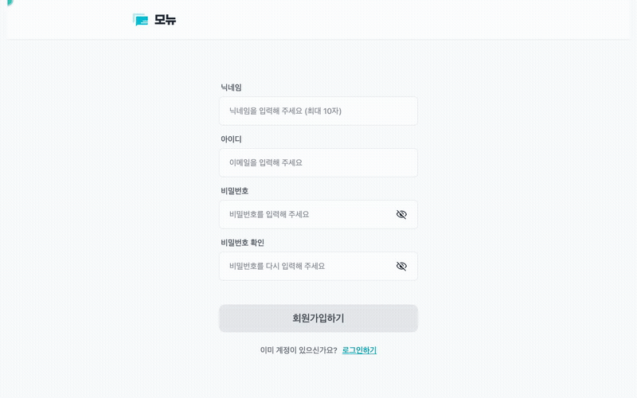<br/>
    <b>회원가입</b><br/>
    <sub>닉네임 · 이메일 · 비밀번호 입력</sub>
  </td>
  <td align="center" width="50%">
    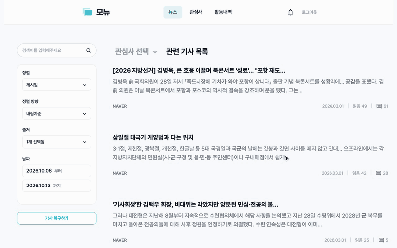<br/>
    <b>뉴스 기사 목록</b><br/>
    <sub>필터 · 정렬 (게시일 · 조회수 · 댓글수)</sub>
  </td>
</tr>
<tr>
  <td align="center" width="50%">
    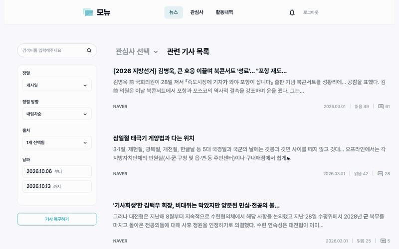<br/>
    <b>기사 상세 · 댓글</b><br/>
    <sub>기사 요약 · 댓글 목록 · 좋아요 수</sub>
  </td>
  <td align="center" width="50%">
    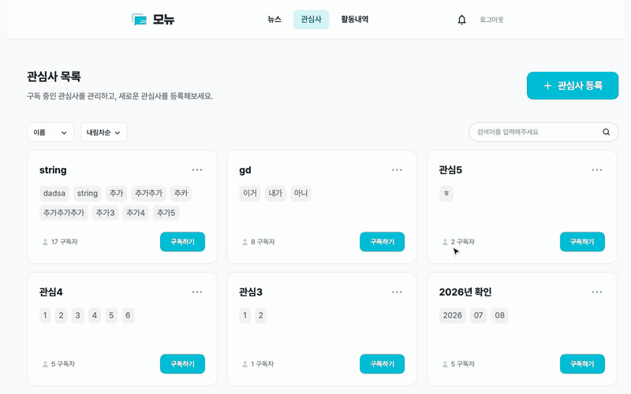<br/>
    <b>관심사 관리</b><br/>
    <sub>관심사 이름 · 키워드 등록 · 구독</sub>
  </td>
</tr>
<tr>
  <td align="center" width="50%">
    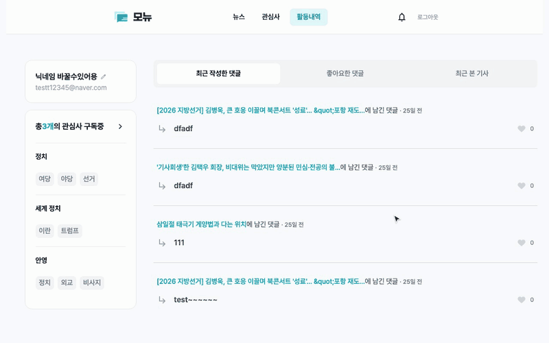<br/>
    <b>사용자 활동 내역</b><br/>
    <sub>작성한 댓글 · 좋아요한 댓글 · 최근 본 기사</sub>
  </td>
  <td align="center" width="50%">
    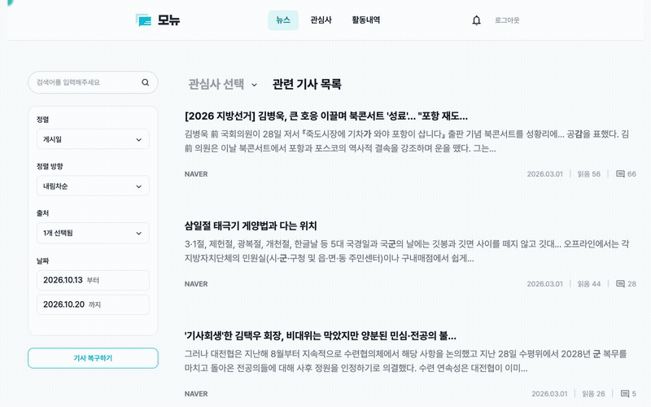<br/>
    <b>알림</b><br/>
    <sub>구독 관심사 새 기사 · 댓글 좋아요 알림</sub>
  </td>
</tr>
</table>

---

## 📌 기술 스택 (임시)

| 구분 | 기술 |
| :--- | :--- |
| **Language** |  |
| **Backend** |  <br> |
| **Database** |   |
| **Cloud & Infra** |   |
| **CI/CD** |   |
| **Test & Quality** |     |
| **Docs** |  |
| **Review** |   |
| **Collaboration** |    |

---

## 📌 주요 기능 (임시 : API 스크린샷은 Swagger 기준 명세 -> 프로젝트 완성 후 변경 예정)

<details>
<summary><b>사용자</b> — 이승현</summary>
<br>

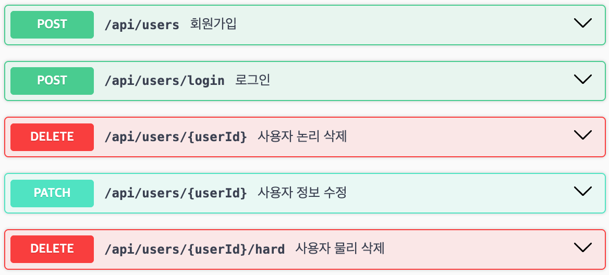

### ✨ 기능

- 회원가입 · 로그인 · 사용자 정보(닉네임) 수정
- 이메일 중복 검사 및 입력값 검증
- 사용자 논리 삭제(탈퇴)
- 논리 삭제 후 일정 기간 경과 시 연관 데이터와 함께 물리 삭제
- 요청 헤더 기반 사용자 식별

### 💡 구현 포인트

- (프로젝트 진행 후 작성 예정 : 구현 스크린샷 또는 PR/이슈 번호 링크 기재)

</details>

<details>
<summary><b>관심사</b> — 박수민</summary>
<br>

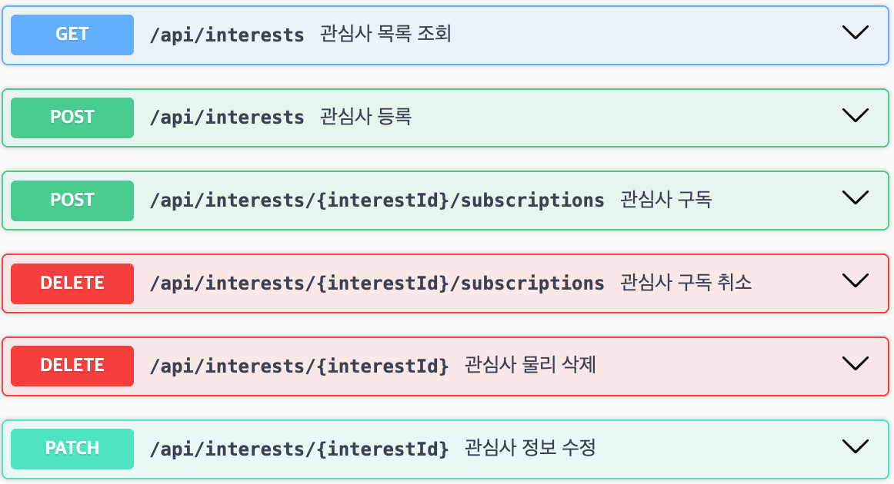

### ✨ 기능

- 관심사 등록 · 목록 조회 · 키워드 수정 · 물리 삭제
- 관심사 이름 유사도 검사로 중복 등록 방지
- 이름 · 키워드 부분 일치 검색
- 이름 · 구독자 수 기준 정렬 및 Cursor Pagination
- 관심사 구독 / 구독 취소 및 구독자 수 관리

### 💡 구현 포인트

- (프로젝트 진행 후 작성 예정 : 구현 스크린샷 또는 PR/이슈 번호 링크 기재)

</details>

<details>
<summary><b>뉴스 기사</b> — 김민재</summary>
<br>

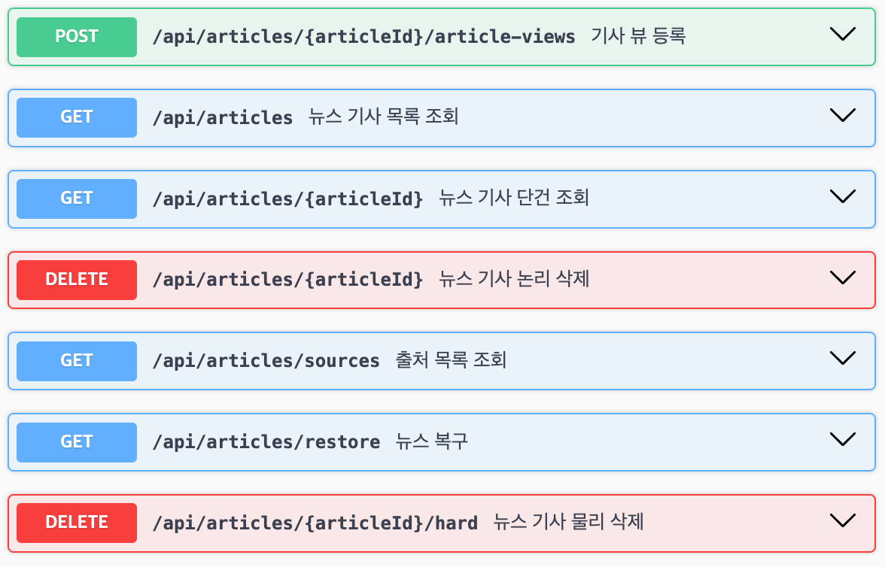

### ✨ 기능

- `@Scheduled` 기반 주기적 뉴스 수집
- Naver 검색 API · 언론사 RSS 기사 수집
- 관심사 키워드가 포함된 기사만 저장, 원본 URL 기준 중복 제거
- 제목 · 요약 키워드 검색, 관심사 · 출처 · 날짜 범위 필터
- 날짜 · 댓글 수 · 조회 수 기준 정렬 및 Cursor Pagination
- 기사 뷰 등록(사용자별 중복 조회 방지) · 출처 목록 조회
- 기사 논리 삭제 / 물리 삭제
- 기사 데이터 AWS S3 일 단위 백업 · 날짜 범위 복구

### 💡 구현 포인트

- (프로젝트 진행 후 작성 예정 : 구현 스크린샷 또는 PR/이슈 번호 링크 기재)

</details>

<details>
<summary><b>배치</b> — 박수민</summary>

### ✨ 기능

- Spring Batch 기반 배치 작업 공통 구조(Job · Step 템플릿) 설계
- `@Scheduled` 기반 배치 스케줄링 공통 설정
- 배치 실행 결과 로그 · 재시도 정책 관리

### 💡 구현 포인트

- (프로젝트 진행 후 작성 예정 : 구현 스크린샷 또는 PR/이슈 번호 링크 기재)

</details>

<details>
<summary><b>댓글</b> — 정수환</summary>
<br>

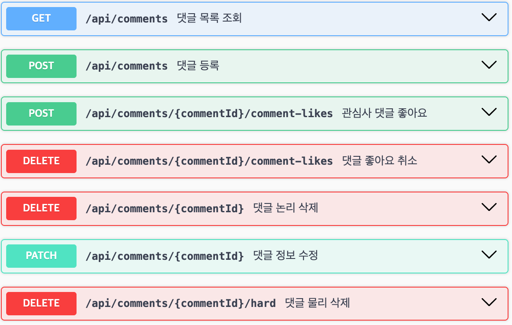

### ✨ 기능

- 댓글 등록 · 목록 조회 · 수정 · 논리 삭제 / 물리 삭제
- 작성자 본인만 수정 · 삭제 가능하도록 권한 검증
- 작성일 · 좋아요 수 기준 정렬 및 Cursor Pagination
- 댓글 좋아요 등록 / 취소 및 중복 좋아요 방지
- 좋아요 수 · 기사 댓글 수 정합성 관리
- 내 댓글에 좋아요가 눌리면 작성자에게 알림 생성

### 💡 구현 포인트

- (프로젝트 진행 후 작성 예정 : 구현 스크린샷 또는 PR/이슈 번호 링크 기재)

</details>

<details>
<summary><b>알림</b> — 이수찬</summary>
<br>

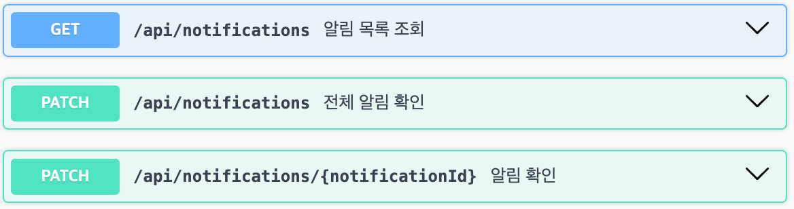

### ✨ 기능

- 구독한 관심사의 새 기사 수집 시 알림 생성
- 내 댓글 좋아요 알림 생성
- 미확인 알림 목록 조회 및 Cursor Pagination
- 단일 / 전체 알림 확인(`confirmed`) 처리
- 확인 후 일정 기간이 지난 알림 배치 자동 삭제

### 💡 구현 포인트

- (프로젝트 진행 후 작성 예정 : 구현 스크린샷 또는 PR/이슈 번호 링크 기재)

</details>

<details>
<summary><b>활동 내역</b> — 이수찬</summary>
<br>

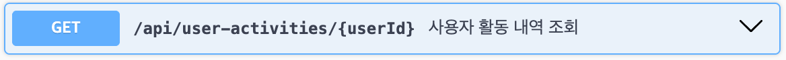

### ✨ 기능

- 구독 중인 관심사 조회
- 최근 작성한 댓글 · 최근 좋아요 누른 댓글 조회
- 최근 본 뉴스 기사 조회
- 댓글 · 좋아요 · 기사 열람 · 구독 내역 통합 응답
- MongoDB 기반 활동 내역 조회 성능 개선(심화)

### 💡 구현 포인트

- (프로젝트 진행 후 작성 예정 : 구현 스크린샷 또는 PR/이슈 번호 링크 기재)

</details>

<details>
<summary><b>공통 · 인프라 · 모니터링 · 패키지 설계</b> — 이승현, 김민재</summary>

### ✨ 기능

- GitHub Actions 기반 CI(빌드 · 테스트 · 커버리지 리포트)
- Docker 이미지 빌드 및 Amazon ECR 업로드
- Amazon ECS 배포, RDS(PostgreSQL) · S3 연동
- 전역 예외 처리 및 공통 에러 응답
- 환경별 설정 분리(local · prod · test)
- Actuator 기반 상태 확인(`/actuator/health`) · Prometheus 지표 수집(`/actuator/prometheus`, 외부 접근 차단)
- 주요 지표(수집 성공 · 실패 건수 등) 확인
- 헥사고날 패키지 구조 설계 - 김민재

### 💡 구현 포인트

- (프로젝트 진행 후 작성 예정 : 구현 스크린샷 또는 PR/이슈 번호 링크 기재)

</details>

---

## 📌 ERD & 아키텍처 (ERD 이미지 다듬을 예정)

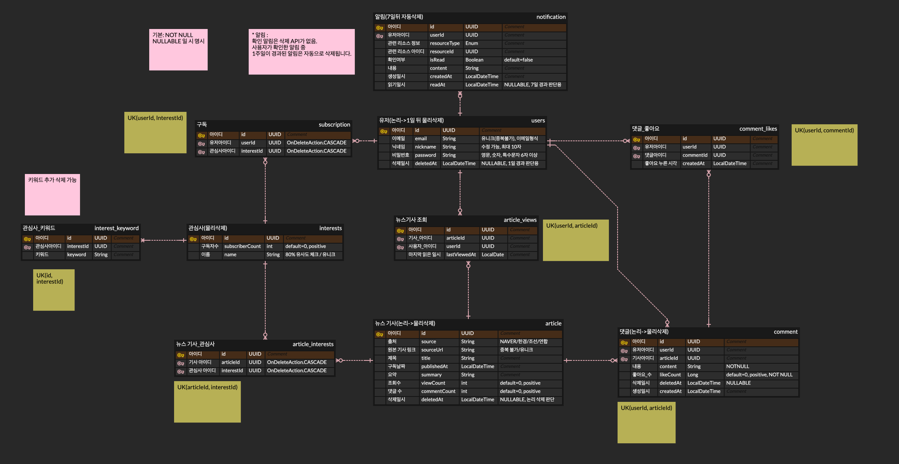

---

## 📌 주요 처리 흐름 (임시)

### 1. 뉴스 기사 자동 수집

```text
@Scheduled (주기 실행)
   ↓
관심사 키워드 목록 조회
   ↓
Naver 검색 API · 언론사 RSS 기사 수집
   ↓
관심사 키워드 포함 기사 필터링
   ↓
원본 URL 기준 중복 제거
   ↓
기사 저장
   ↓ 새 기사가 있으면
구독자에게 알림 생성
```

### 2. 기사 백업 · 복구

**백업**

```text
매일 배치 실행
   ↓
전날 수집 기사 조회
   ↓
JSON 직렬화
   ↓
Amazon S3 업로드 (날짜별 파일)
```

**복구**

```text
복구 요청 (날짜 범위)
   ↓
S3 백업 파일 조회
   ↓
DB에 없는 기사 선별
   ↓
유실 기사만 복원
```

### 3. 댓글 좋아요 → 알림

```text
댓글 좋아요 등록
        ↓
CommentLikedEvent 발행
        ↓
Transaction COMMIT
        ↓
@TransactionalEventListener
        ↓
댓글 작성자에게 Notification 생성
```

### 4. 사용자 활동 내역 (심화)

```text
댓글 · 좋아요 · 기사 열람 · 구독 발생
        ↓
활동 이벤트 발행
        ↓
MongoDB 사용자 활동 문서 갱신
        ↓
활동 내역 조회 시 문서 1건으로 응답
```

### 5. CI/CD

```text
PR → CI(빌드 · 테스트) 통과 → develop 머지
   ↓
GitHub Actions
   ↓
Test
   ↓
JaCoCo Coverage Report
   ↓
Codecov Upload
   ↓
Docker Image Build
   ↓
Amazon ECR Push
   ↓
Amazon ECS Deploy
```

---

## 📌 배포 구조 (임시)

```text
                       ┌───────────────┐
                       │     GitHub    │
                       └───────┬───────┘
                               │
                               ▼
                       ┌───────────────┐
                       │ GitHub Actions│
                       └───────┬───────┘
                               │
                               ▼
                       ┌───────────────┐
                       │     Docker    │
                       └───────┬───────┘
                               │
                               ▼
                       ┌───────────────┐
                       │   Amazon ECR  │
                       └───────┬───────┘
                               │
                               ▼
                       ┌───────────────┐
                       │   Amazon ECS  │
                       └───────┬───────┘
                               │
             ┌─────────────────┼─────────────────┐
             ▼                 ▼                 ▼
      ┌─────────────┐   ┌─────────────┐   ┌─────────────┐
      │     RDS     │   │   MongoDB   │   │  Amazon S3  │
      │  PostgreSQL │   │   Activity  │   │    Backup   │
      └─────────────┘   └─────────────┘   └─────────────┘
```

---

## 📌 테스트 및 품질 관리 (임시)

<details>
<summary>[펼쳐보기]</summary>
<br>

### CI

`main` · `develop`으로 가는 Pull Request와 `develop` 머지(push) 때
GitHub Actions CI가 실행됩니다. (문서만 바뀐 경우는 빌드 생략)

```bash
./gradlew build
```

**검증 및 리포트 항목**

- 전체 테스트 실행
- JaCoCo 커버리지 리포트(XML) 생성
- Codecov로 커버리지 리포트 업로드
- Codecov를 통한 커버리지 결과 확인
- CodeRabbit · Claude Code 기반 PR 자동 리뷰

> 테스트는 Testcontainers로 실제 PostgreSQL·MongoDB 컨테이너를 띄워 실행합니다 (Docker 필요).

### 로컬 테스트 실행

```bash
# macOS / Linux
./gradlew clean test jacocoTestReport

# Windows
.\gradlew.bat clean test jacocoTestReport
```

| 산출물 | 경로 |
| :--- | :--- |
| 테스트 결과 | `build/reports/tests/test/index.html` |
| JaCoCo HTML | `build/reports/jacoco/test/html/index.html` |
| JaCoCo XML | `build/reports/jacoco/test/jacocoTestReport.xml` |

</details>

---

## 📌 개발 규칙 (임시)

| 구분 | 규칙 |
| :--- | :--- |
| 브랜치 전략 | `{타입}/{이슈번호}-{작업명}` → `develop` → `main` (예: `feat/12-interest-subscribe`) |
| 커밋 컨벤션 | `타입 : 작업 내용 [#이슈번호]` (예: `feat : 관심사 구독 API 추가 [#12]`) — 이슈 번호는 브랜치 이름에서 자동으로 붙음, TDD 단계는 `test(red)` · `feat(green)` · `refactor(blue)` |
| PR 규칙 | 이슈 연결(`close #이슈번호`) · 리뷰 승인 후 **일반 머지가 기본**(TDD 단계 커밋을 develop에 그대로 남김) |
| 코드 스타일 | Spotless(google-java-format `aosp()`, 들여쓰기 4칸) — 커밋 시 Git Hook으로 자동 적용, **최종 포맷 기준** |
| 기본 에디터 설정 | `.editorconfig` — 인코딩(UTF-8)·줄바꿈(LF)·줄 끝 공백 제거 등을 에디터 종류와 무관하게 통일 (IntelliJ 포함 대부분의 에디터가 자동 인식) |
| 저장 시 자동 포맷팅 | 인텔리제이를 **닫은 상태**에서 `./gradlew installIntellijActionsOnSave` 1회 실행 (Java 파일 저장할 때마다 리포맷 + import 정리 — 편의용이며, 커밋 시 Spotless가 다시 한 번 기준에 맞춰 정리함) |

> 자세한 컨벤션은 [팀 Notion](https://app.notion.com/p/SB14-Monew-Team03-7589e310974382c2a2e001fa888a5a22)을 참고합니다.

---

## 📌 로컬 개발 환경 구동 방법 (임시)

> 지금 바로 세팅하려면 [SETUP.md](./SETUP.md)를 참고하세요. 아래 접은 글은
> 프로젝트 완성 후 최종 수정할 예정인 README 양식입니다.

<details>
<summary>[펼쳐보기]</summary>
<br>

> **README 양식 예시입니다.**<br>
> 환경 변수 · 인프라 구성은 팀 미팅에서 함께 논의한 뒤 최종 확정할 예정입니다.

**요구사항**

- JDK 17
- Docker Desktop (실행 중이어야 함)

**1. 저장소 받기**

```bash
git clone https://github.com/SB14-HJ3S/sb14-monew-team03.git
cd sb14-monew-team03
```

**2. 환경 변수**

`.env.example`을 복사해 `.env`를 만들고 값을 채웁니다.

```bash
cp .env.example .env
```

| 값 | 용도 |
| :--- | :--- |
| `AWS_ACCESS_KEY_ID` · `AWS_SECRET_ACCESS_KEY` · `AWS_S3_BUCKET` | 로컬에서 S3 기능(기사 백업 · 복구, 로그 적재) 테스트용 — 로컬 전용 버킷 |
| `NAVER_API_CLIENT_ID` · `NAVER_API_CLIENT_SECRET` | 뉴스 수집용 네이버 API 키 |

> 비밀값은 저장소에 커밋하지 않습니다. (`.env`는 `.gitignore`에 등록)<br>
> 로컬 DB 접속 정보는 `compose.yaml`에 고정돼 있어서 `.env`에 적지 않습니다.

**(선택) direnv로 쉘에도 자동 연동**

`.env`는 스프링 앱에만 읽히므로, 터미널에서 `aws` CLI 등 외부 명령어도 같은 값으로 쓰려면 [direnv](https://direnv.net/)를 추가로 설정합니다.

```bash
brew install direnv
# 쉘 설정 파일(.zshrc 등)에 추가 후 터미널 재시작
echo 'eval "$(direnv hook zsh)"' >> ~/.zshrc
direnv allow   # 프로젝트 폴더에서 한 번만 실행
```

**3. 로컬 인프라**

앱을 실행하면 `compose.yaml`의 DB 컨테이너가 자동으로 같이 뜹니다. 직접 띄우려면:

```bash
docker compose up -d
```

| 서비스 | 주소 |
| :--- | :--- |
| PostgreSQL 16 | `localhost:5432` (DB `monew`) |
| MongoDB 7 | `localhost:27017` |

**4. 애플리케이션 실행**

```bash
# macOS / Linux
./gradlew bootRun

# Windows
.\gradlew.bat bootRun
```

| 대상 | 주소 |
| :--- | :--- |
| 웹 화면 | http://localhost:8080 |
| Swagger UI | http://localhost:8080/swagger-ui/index.html |
| OpenAPI JSON | http://localhost:8080/v3/api-docs |
| 서버 상태 | http://localhost:8080/actuator/health |

**5. 테스트**

```bash
./gradlew test
```

> 테스트는 Testcontainers(PostgreSQL · MongoDB)로 실행되며, 커버리지 리포트(JaCoCo)가 함께 생성됩니다. Docker Desktop을 켜 두세요.

**6. 종료**

```bash
docker compose down
```

> 로컬 데이터까지 지워야 할 때만 `docker compose down --volumes`를 실행합니다.

</details>

---

## 📌 프로젝트 패키지 전체 구조 살펴보기 (임시)

> **README 양식 테스트용 예시입니다.**<br>
> 패키지 나누기 · 레이어 구성 · 사용 기술은 아직 정해지지 않았으며, 팀 미팅에서 함께 논의한 뒤 실제 구조로 교체할 예정입니다.<br>
> 아래 트리는 「이런 형태로 정리하면 좋겠다」는 참고용 초안입니다.

### 1. 전체 구성 (간단.Ver)

```
sb14-monew-team03/
├── .github/                        # 이슈 · PR 템플릿, CI 워크플로
├── docs/                           # README 이미지 · 문서
├── gradle/                         # Gradle Wrapper
├── src/
│   ├── main/
│   │   ├── java/com/sprint/monew/  # 백엔드 소스
│   │   └── resources/              # 설정 파일 · 프론트엔드 빌드 결과물
│   └── test/                       # 테스트 코드
├── {기타 설정 파일}                # 예) 환경변수 예시 · 로컬 DB 컨테이너 · 배포 설정 (팀 논의 후 확정)
├── build.gradle                    # 의존성 · 빌드 설정
└── README.md                       # 프로젝트 소개
```

### 2. 도메인 구성 (간단.Ver)

```
src/main/java/com/sprint/monew
├── domain/            # 도메인별 패키지
│   ├── user/          # 회원가입 · 로그인 · 탈퇴 (이승현)
│   ├── interest/      # 관심사 등록 · 구독 (박수민)
│   ├── article/       # 뉴스 기사 수집 · 조회 · 백업 / 복구 (김민재)
│   ├── comment/       # 댓글 · 좋아요 (정수환)
│   ├── notification/  # 알림 생성 · 확인 (이수찬)
│   └── useractivity/  # 사용자 활동 내역 조회 (이수찬)
└── {공통 패키지}/     # 예) 설정 · 예외 처리 · 공통 응답 (팀 논의 후 확정)
```

각 도메인 내부의 계층 구성은 팀 논의 후 정할 예정입니다.

### 3. 전체 패키지 구성 (상세.Ver) - 최종 수정시 실제 프로젝트 구조로 변경 예정

<details>
<summary>[펼쳐보기]</summary>

```
src/
├── main/
│   ├── java/com/sprint/monew/
│   │   ├── MonewApplication.java   # 애플리케이션 시작점
│   │   ├── domain/                 # 도메인별 패키지
│   │   │   ├── user/               # 사용자 (이승현)
│   │   │   │   ├── controller/     # (예시) API 요청 · 응답 처리
│   │   │   │   ├── dto/            # (예시) 요청 · 응답 데이터
│   │   │   │   ├── entity/         # (예시) DB 테이블과 매핑되는 객체
│   │   │   │   ├── repository/     # (예시) DB 조회 · 저장
│   │   │   │   └── service/        # (예시) 비즈니스 로직
│   │   │   ├── interest/           # 관심사 (박수민)
│   │   │   │   └── ...             # 계층 구성은 팀 논의 후 확정
│   │   │   ├── article/            # 뉴스 기사 (김민재)
│   │   │   │   └── ...             # 계층 구성은 팀 논의 후 확정
│   │   │   ├── comment/            # 댓글 (정수환)
│   │   │   │   └── ...             # 계층 구성은 팀 논의 후 확정
│   │   │   ├── notification/       # 알림 (이수찬)
│   │   │   │   └── ...             # 계층 구성은 팀 논의 후 확정
│   │   │   └── useractivity/       # 사용자 활동 내역 (이수찬)
│   │   │       └── ...             # 계층 구성은 팀 논의 후 확정
│   │   └── {공통 패키지}/          # 도메인 공통 코드 (이름 · 구성 팀 논의 후 확정)
│   │       ├── config/             # (예시) 설정
│   │       ├── exception/          # (예시) 예외 처리
│   │       └── common/             # (예시) 공통 응답 · 유틸리티
│   └── resources/
│       ├── application.yml         # 공통 설정
│       ├── application-{환경}.yml  # 환경별 설정 (환경 구분 팀 논의 후 확정)
│       └── static/                 # 코드잇 제공 프론트엔드 빌드 결과물
└── test/
    ├── java/com/sprint/monew/      # 도메인별 테스트 코드
    └── resources/                  # 테스트 환경 설정
```

</details>

---

<div align="center">

### 📰 MONEW

: 관심 있는 뉴스를 모으고, 읽고, 함께 이야기하는 공간

<br/>

[⬆️ 위로가기](#top)

</div>
