<a name="top"></a>

> [!NOTE]
> *해당 문서는 초안으로 확정된 것이 아닙니다! README 문서 틀만 잡아 놓은 것으로,*<br>
> *정확한 내용(담당, 패키지 구조 내용 등)은 프로젝트 완성 후 최종 수정 예정입니다.*

<div align="center">

[](https://github.com/SB14-HJ3S/sb14-monew-team03/actions/workflows/ci.yml?query=branch%3Adevelop)
[](https://app.codecov.io/gh/SB14-HJ3S/sb14-monew-team03/tree/develop)

<!-- develop의 CI 실행 완료 후 갱신. 청록: 성공 또는 커버리지 80% 이상, 밝은 분홍: 실패 또는 80% 미만, 연한 회색: 취소 또는 결과 없음. -->

<a href="https://monew.is-a.dev/">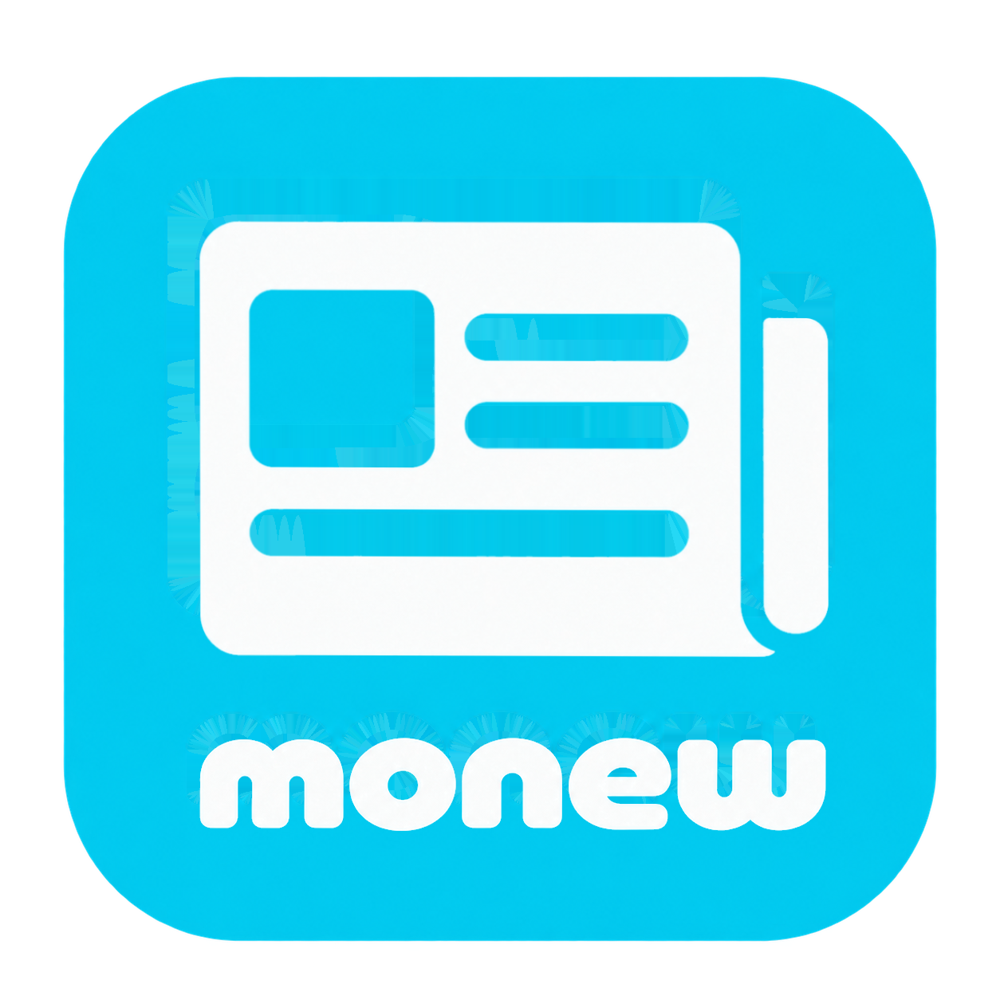</a>

<table align="center">
<tr>
  <td align="left"><b>모뉴 기간</b></td>
  <td align="left">2026.10.20 ~ 2026.11.09</td>
</tr>
<tr>
  <td align="left" valign="top"><b>모뉴 설명</b></td>
  <td align="left">넘쳐나는 뉴스 속에서 <b>'나에게 맞는 뉴스'</b>만 보고 싶은 사용자를 위해,<br>관심사에 맞춰 뉴스를 자동으로 수집하고 댓글 · 좋아요 · 알림으로 <br><b>함께 이야기하는 개인화 뉴스 플랫폼 📰 </b>입니다.</td>
</tr>
<tr>
  <td align="left" valign="top"><b>핵심 목표</b></td>
  <td align="left">· 관심사 기반 뉴스 큐레이션 및 자동 수집<br>· 사용자 활동(댓글, 좋아요, 알림) 통합 관리<br>· 스케줄러 기반 기사 동기화 및 S3 백업 · 복구 기능<br>· Actuator 기반 모니터링으로 운영 관찰성 확보</td>
</tr>
<tr>
  <td align="left"><b>관련 링크</b></td>
  <td align="left"><a href="https://monew.is-a.dev/">🌐 배포 링크</a> &nbsp;|&nbsp; <a href="https://monew.is-a.dev/swagger-ui/index.html">📑 API 문서</a> &nbsp;|&nbsp; <a href="https://github.com/SB14-HJ3S/sb14-monew-team03">💻 GitHub</a> &nbsp;|&nbsp; <a href="https://app.notion.com/p/SB14-Monew-Team03-7589e310974382c2a2e001fa888a5a22">📝 Notion</a> &nbsp;|&nbsp; <a href="https://github.com/orgs/SB14-HJ3S/projects/3">📆 Git Projects</a> &nbsp;|&nbsp; <a href="https://github.com/SB14-HJ3S/sb14-monew-team03/discussions">🗂️ Discussions</a></td>
</tr>
</table>

<sub>※ 배포 데모 접속 링크는 <b>2026년 11월 17일 23시 59분</b>까지 운영되며, 이후에는 접속이 종료됩니다.</sub>

</div>

---

<p align="center">
  
</p>

## 📌 현.재.삼.수 멤버 5인 소개

<table align="center">
<tr>
  <td align="center" width="180">
    <a href="https://github.com/mjdevkim"></a><br/>
    <a href="https://github.com/mjdevkim"></a>
  </td>
  <td align="center" width="180">
    <a href="https://github.com/ssoomni52"></a><br/>
    <a href="https://github.com/ssoomni52"></a>
  </td>
  <td align="center" width="180">
    <a href="https://github.com/lsc0869"></a><br/>
    <a href="https://github.com/lsc0869"></a>
  </td>
  <td align="center" width="180">
    <a href="https://github.com/Hanna-log"></a><br/>
    <a href="https://github.com/Hanna-log"></a>
  </td>
  <td align="center" width="180">
    <a href="https://github.com/swanhw"></a><br/>
    <a href="https://github.com/swanhw"></a>
  </td>
</tr>
<tr>
  <td align="center"><a href="https://app.notion.com/p/8649e310974383be8106818c94ed3a14">📝 개발 리포트</a></td>
  <td align="center"><a href="https://app.notion.com/p/c679e3109743836c8b7281289df7403a">📝 개발 리포트</a></td>
  <td align="center"><a href="https://app.notion.com/p/3309e3109743836895860154ffeca8ca">📝 개발 리포트</a></td>
  <td align="center"><a href="https://app.notion.com/p/8609e3109743824d88e18146d3653ede">📝 개발 리포트</a></td>
  <td align="center"><a href="https://app.notion.com/p/a5d9e310974383f1962e812f40211f0f">📝 개발 리포트</a></td>
</tr>
<tr>
  <td align="center" valign="top"><b>김민재</b><br/>기술팀장<br/><br/><sub><kbd><b>뉴스&nbsp;기사&nbsp;도메인</b></kbd>&nbsp;⭐<br/>·&nbsp;네이버&nbsp;API&nbsp;·&nbsp;RSS&nbsp;수집<br/>·&nbsp;기사&nbsp;검색&nbsp;·&nbsp;조회수<br/>·&nbsp;기사&nbsp;S3&nbsp;백업&nbsp;·&nbsp;복구<br/><kbd><b>공통</b></kbd><br/>·&nbsp;헥사고날&nbsp;패키지&nbsp;설계<br/>·&nbsp;도메인별&nbsp;엔티티&nbsp;설계</sub></td>
  <td align="center" valign="top"><b>박수민</b><br/>기술부팀장<br/><br/><sub><kbd><b>관심사&nbsp;도메인</b></kbd><br/>·&nbsp;관심사&nbsp;등록&nbsp;·&nbsp;수정&nbsp;·&nbsp;삭제<br/>·&nbsp;관심사&nbsp;이름&nbsp;유사도&nbsp;검사<br/>·&nbsp;관심사&nbsp;구독&nbsp;·&nbsp;취소<br/><kbd><b>Spring&nbsp;Batch&nbsp;적용</b></kbd>&nbsp;🚀<br/>·&nbsp;배치&nbsp;로그&nbsp;S3&nbsp;적재<br/>·&nbsp;배치&nbsp;메트릭&nbsp;모니터링<br/><kbd><b>공통</b></kbd><br/>·&nbsp;도메인별&nbsp;UseCase&nbsp;·&nbsp;Port&nbsp;정의<br/>·&nbsp;커서&nbsp;페이지네이션<br/>·&nbsp;요청자&nbsp;ID&nbsp;처리</sub></td>
  <td align="center" valign="top"><b>이수찬</b><br/>팀원<br/><br/><sub><kbd><b>알림&nbsp;도메인</b></kbd><br/>·&nbsp;기사&nbsp;·&nbsp;좋아요&nbsp;알림&nbsp;생성<br/>·&nbsp;알림&nbsp;조회&nbsp;·&nbsp;확인&nbsp;처리<br/>·&nbsp;오래된&nbsp;알림&nbsp;삭제&nbsp;배치<br/><kbd><b>활동&nbsp;내역&nbsp;도메인</b></kbd>&nbsp;🚀<br/>·&nbsp;활동&nbsp;내역&nbsp;조회<br/>·&nbsp;MongoDB&nbsp;조회&nbsp;최적화</sub></td>
  <td align="center" valign="top"><b>이승현</b><br/>행정팀장<br/><br/><sub><kbd><b>사용자&nbsp;도메인</b></kbd><br/>·&nbsp;회원가입&nbsp;·&nbsp;로그인<br/>·&nbsp;닉네임&nbsp;수정<br/>·&nbsp;논리&nbsp;·&nbsp;물리&nbsp;삭제<br/>·&nbsp;탈퇴&nbsp;사용자&nbsp;삭제&nbsp;배치<br/><kbd><b>뉴스&nbsp;기사&nbsp;도메인</b></kbd><br/>·&nbsp;출처&nbsp;목록&nbsp;조회<br/>·&nbsp;기사&nbsp;논리&nbsp;·&nbsp;물리&nbsp;삭제<br/><kbd><b>AWS&nbsp;무중단&nbsp;자동&nbsp;배포</b></kbd><br/>·&nbsp;모니터링&nbsp;환경&nbsp;구축<br/><kbd><b>공통</b></kbd><br/>·&nbsp;공통&nbsp;코드&nbsp;·&nbsp;예외<br/>·&nbsp;Swagger&nbsp;설정<br/>·&nbsp;CI&nbsp;·&nbsp;협업&nbsp;자동화</sub></td>
  <td align="center" valign="top"><b>정수환</b><br/>팀원<br/><br/><sub><kbd><b>댓글&nbsp;도메인</b></kbd><br/>·&nbsp;댓글&nbsp;등록&nbsp;·&nbsp;수정<br/>·&nbsp;댓글&nbsp;논리&nbsp;·&nbsp;물리&nbsp;삭제<br/>·&nbsp;기사별&nbsp;댓글&nbsp;목록&nbsp;조회<br/>·&nbsp;댓글&nbsp;좋아요&nbsp;·&nbsp;취소</sub></td>
</tr>
</table>

<p align="center"><sub>⭐ 핵심 도메인 (프로젝트 주제인 백업 · 복구 시스템의 중심) &nbsp;·&nbsp; 🚀 심화 요구사항</sub></p>

---

## 📌 개발 일정

| 단계 | 기간 | 주요 작업 |
|:---|:---|:---|
| **기획 · 설계** | `09.29 ~ 09.30` | 주제 선정 조사 및 최종 주제 확정<br>요구사항 분석, ERD · API 명세 정리, 역할 분담 |
| **공통 설계** | `10.12 ~ 10.21` | 요구사항 분석, 팀 ERD, 팀 컨벤션, 패키지 · 엔티티 · 인터페이스 설계<br>프로젝트 초기 세팅, 공통 예외 · 응답 포맷, CI 구성 |
| **1차 개발** | `10.21 ~ 10.27` | 1차 스프린트: 도메인별 핵심 기능 구현 (사용자 · 관심사 · 뉴스 · 댓글 · 알림) |
| **중간 발표** | `10.28` | 중간 발표 |
| **2차 개발** | `10.29 ~ 11.05` | 2차 스프린트: 남은 도메인별 핵심 기능 구현 (사용자 · 관심사 · 뉴스 · 댓글 · 알림)<br>배치 · 백업 · 모니터링 등 심화 기능, 리팩토링 |
| **최종 발표 준비** | `11.06 ~ 11.08` | 최종 발표자료 준비 및 배포 검토 |
| **마무리 · 발표** | `11.09` | 최종 발표 |
| **배포** | `10.21 ~ 11.17` | AWS 배포 및 배포 자동화 |

---

## 📌 서비스 화면

<table>
<tr>
  <td align="center" width="50%">
    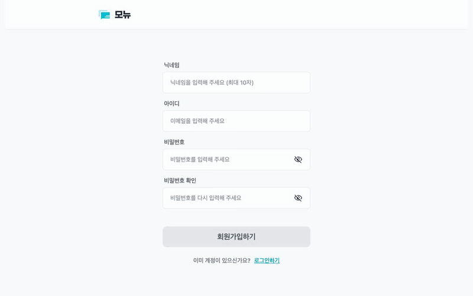<br/>
    <b>회원가입</b><br/>
    <sub>닉네임 · 이메일 · 비밀번호 입력 · 가입 완료</sub>
  </td>
  <td align="center" width="50%">
    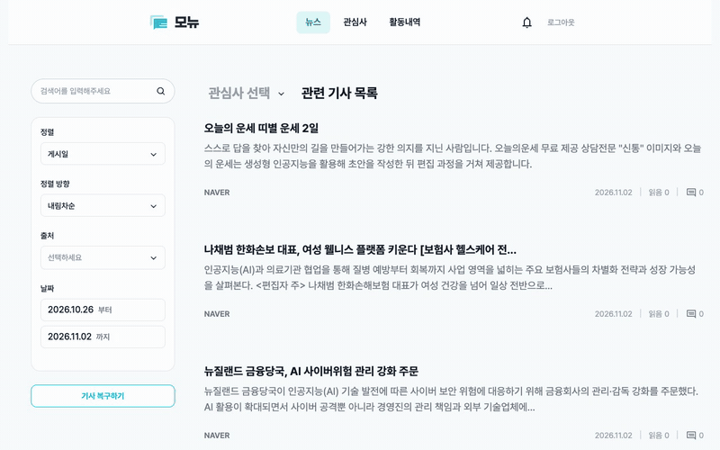<br/>
    <b>뉴스 기사 목록</b> <sub>(구현 후 수정 예정)</sub><br/>
    <sub>검색 · 정렬 (게시일 · 조회수 · 댓글수) · 필터</sub>
  </td>
</tr>
<tr>
  <td align="center" width="50%">
    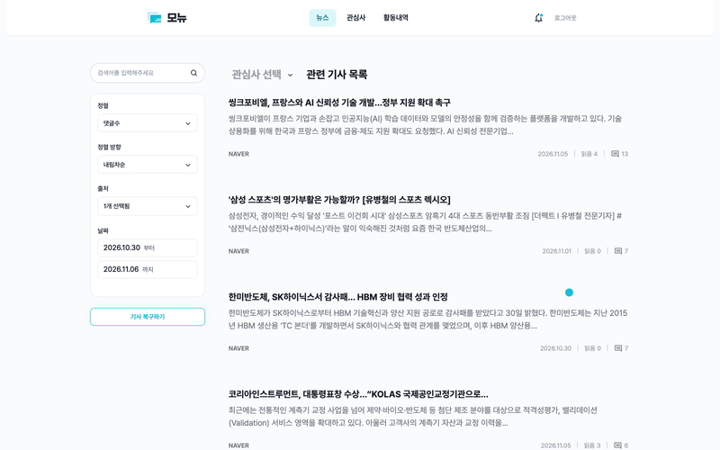<br/>
    <b>기사 상세 · 댓글</b> <sub>(구현 후 수정 예정)</sub><br/>
    <sub>기사 요약 · 댓글 목록 · 좋아요 수</sub>
  </td>
  <td align="center" width="50%">
    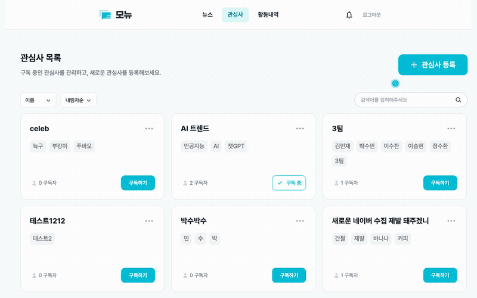<br/>
    <b>관심사 관리</b><br/>
    <sub>관심사 · 키워드 등록 · 수정 · 삭제 · 유사 이름 등록 불가</sub>
  </td>
</tr>
<tr>
  <td align="center" width="50%">
    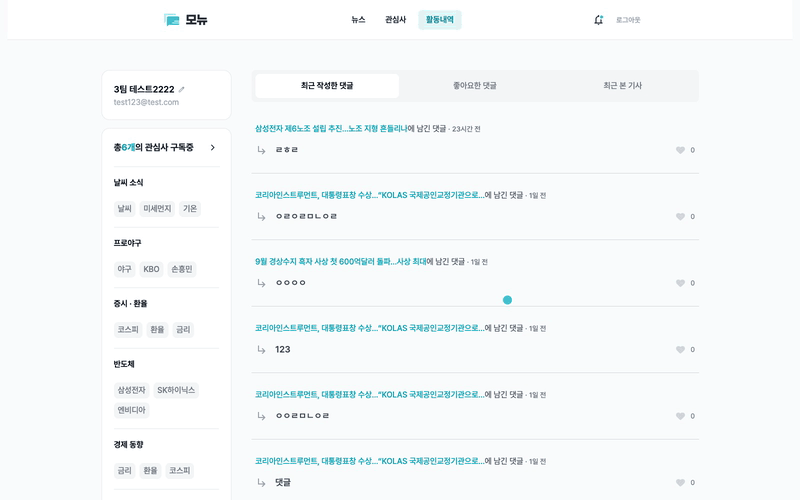<br/>
    <b>사용자 활동 내역</b> <sub>(구현 후 수정 예정)</sub><br/>
    <sub>작성한 댓글 · 좋아요한 댓글 · 최근 본 기사</sub>
  </td>
  <td align="center" width="50%">
    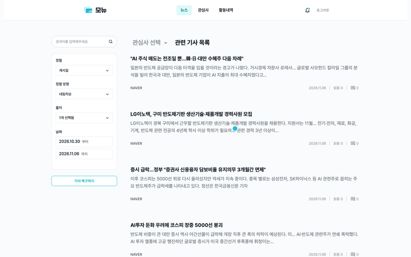<br/>
    <b>알림</b> <sub>(구현 후 수정 예정)</sub><br/>
    <sub>구독 관심사 새 기사 · 댓글 좋아요 알림</sub>
  </td>
</tr>
</table>

---

## 📌 기술 스택

| 구분 | 기술 |
| :--- | :--- |
| **Language** |  |
| **Backend** |  <br> |
| **Database** |   |
| **Cloud & Infra** |   |
| **Monitoring** |    |
| **CI/CD** |   |
| **Test & Quality** |    <br>  |
| **Docs** |  |
| **Review** |   |
| **Collaboration** |    |

---

## 📌 주요 기능

<a id="feature-1"></a>

<details>
<summary><b>사용자</b> — 이승현</summary>
<br>

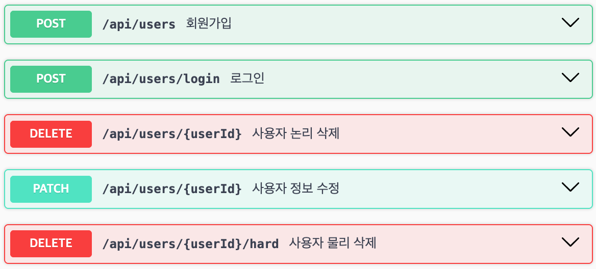

### ✨ 기능

- 회원가입 · 로그인 · 사용자 정보(닉네임) 수정
- 이메일 중복 검사 및 입력값 검증
- 사용자 논리 삭제(탈퇴)
- 논리 삭제 후 일정 기간 경과 시 연관 데이터와 함께 물리 삭제
- 요청 헤더 기반 사용자 식별

### 💡 구현 포인트

- 활성 사용자 조회: 탈퇴(논리 삭제)한 사용자는 로그인 · 조회 대상에서 빠지도록 사용자 조회를 활성 사용자 기준으로 통일하고, 여러 명을 한 번에 조회하는 메서드도 제공 ([#128](https://github.com/SB14-HJ3S/sb14-monew-team03/pull/128), [#179](https://github.com/SB14-HJ3S/sb14-monew-team03/pull/179), [#181](https://github.com/SB14-HJ3S/sb14-monew-team03/pull/181))
- 이벤트 발행: 가입 · 닉네임 수정 · 물리 삭제 시 이벤트를 발행해, 활동 내역 등 다른 도메인이 사용자 코드에 직접 의존하지 않고 후속 처리 ([#185](https://github.com/SB14-HJ3S/sb14-monew-team03/pull/185), [#200](https://github.com/SB14-HJ3S/sb14-monew-team03/pull/200))
- 회원가입: 입력값을 검증하고, 이미 가입된 이메일이면 409(`USER_EMAIL_DUPLICATED`)로 응답 ([#159](https://github.com/SB14-HJ3S/sb14-monew-team03/pull/159))
  <br>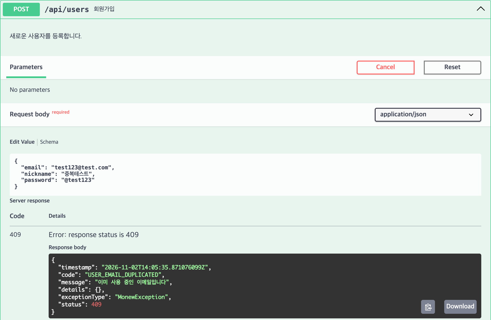
- 로그인 · 닉네임 수정: 이메일 · 비밀번호 중 무엇이 틀려도 같은 에러로 응답해 가입 여부를 노출하지 않고, 탈퇴한 사용자는 로그인 · 수정 대상에서 제외 ([#187](https://github.com/SB14-HJ3S/sb14-monew-team03/pull/187), [#211](https://github.com/SB14-HJ3S/sb14-monew-team03/pull/211))
- 논리 · 물리 삭제: 탈퇴 시 삭제 표시만 하고, 물리 삭제는 이미 논리 삭제된 사용자만 대상으로 연관 데이터까지 함께 삭제 ([#252](https://github.com/SB14-HJ3S/sb14-monew-team03/pull/252), [#271](https://github.com/SB14-HJ3S/sb14-monew-team03/pull/271))
- Swagger: 사용자 API별 설명과 에러 응답 예시 추가 ([#265](https://github.com/SB14-HJ3S/sb14-monew-team03/pull/265))
- 서비스 · 컨트롤러 모두 테스트 먼저 작성(Red) → 구현(Green) → 정리(Refactor) 순서로 개발


<p align="right"><a href="#feature-1">⬆️ 맨 위로 (제목을 눌러 접기)</a></p>

</details>

<a id="feature-2"></a>

<details>
<summary><b>관심사</b> — 박수민</summary>
<br>

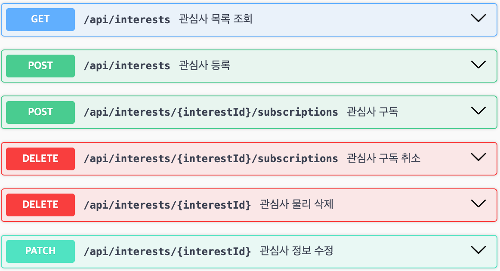

### ✨ 기능

- 관심사 등록 · 목록 조회 · 키워드 수정 · 물리 삭제
- 관심사 이름 유사도 검사로 중복 등록 방지
- 이름 · 키워드 부분 일치 검색
- 이름 · 구독자 수 기준 정렬 및 Cursor Pagination
- 관심사 구독 / 구독 취소 및 구독자 수 관리

### 💡 구현 포인트

- (프로젝트 진행 후 작성 예정 : 구현 스크린샷 또는 PR/이슈 번호 링크 기재)


<p align="right"><a href="#feature-2">⬆️ 맨 위로 (제목을 눌러 접기)</a></p>

</details>

<a id="feature-3"></a>

<details>
<summary><b>뉴스 기사 (수집 · 조회 · 백업)</b> — 김민재</summary>
<br>

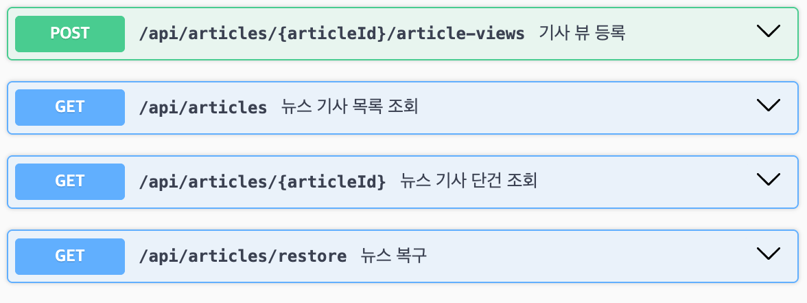

### ✨ 기능

- `@Scheduled` 기반 주기적 뉴스 수집
- Naver 검색 API · 언론사 RSS 기사 수집
- 관심사 키워드가 포함된 기사만 저장, 원본 URL 기준 중복 제거
- 제목 · 요약 키워드 검색, 관심사 · 출처 · 날짜 범위 필터
- 날짜 · 댓글 수 · 조회 수 기준 정렬 및 Cursor Pagination
- 기사 뷰 등록(사용자별 중복 조회 방지)
- 기사 데이터 AWS S3 일 단위 백업 · 날짜 범위 복구

### 💡 구현 포인트

- (프로젝트 진행 후 작성 예정 : 구현 스크린샷 또는 PR/이슈 번호 링크 기재)


<p align="right"><a href="#feature-3">⬆️ 맨 위로 (제목을 눌러 접기)</a></p>

</details>

<a id="feature-4"></a>

<details>
<summary><b>뉴스 기사 (출처 · 삭제)</b> — 이승현</summary>
<br>

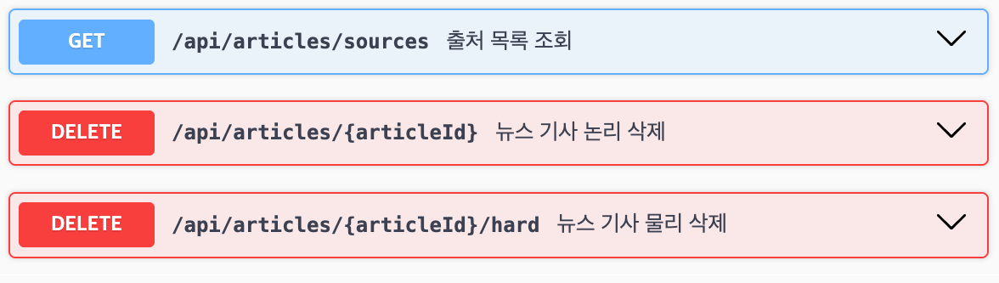

### ✨ 기능

- 출처 목록 조회 (기사 목록 출처 필터 선택지)
- 기사 논리 삭제
- 기사 물리 삭제 (연관 정보 함께 삭제)

### 💡 구현 포인트

- 기사 논리 삭제 · 물리 삭제 이벤트를 먼저 정의해, 연관 도메인 담당자가 구독 처리를 병렬로 구현할 수 있게 함 ([#277](https://github.com/SB14-HJ3S/sb14-monew-team03/pull/277), [#280](https://github.com/SB14-HJ3S/sb14-monew-team03/pull/280))
- 출처 목록 조회: 수집 출처(`ArticleSourceType`: NAVER · HANKYUNG · CHOSUN · YEONHAP) 전체를 반환해 기사 목록의 출처 필터 선택지로 사용 ([#291](https://github.com/SB14-HJ3S/sb14-monew-team03/pull/291))
- 논리 삭제: 기사 데이터는 남기고 `deletedAt`만 기록. 삭제되지 않은 기사만 지우는 조건부 UPDATE로, 없거나 이미 삭제된 기사면 404로 응답하고, 커밋 뒤 이벤트로 활동 내역(MongoDB)에서 해당 기사 제외 ([#298](https://github.com/SB14-HJ3S/sb14-monew-team03/pull/298))
- 물리 삭제: 기사 행만 지우면 댓글 · 댓글 좋아요 · 기사 조회 기록 · 기사-관심사 연결은 DB의 `ON DELETE CASCADE`로 함께 삭제되고, FK가 없는 댓글 좋아요 알림과 활동 내역은 삭제 직전 이벤트로 정리. 통합 테스트로 검증 ([#312](https://github.com/SB14-HJ3S/sb14-monew-team03/pull/312))
- 서비스 · 컨트롤러 모두 테스트 먼저 작성(Red) → 구현(Green) → 정리(Refactor) 순서로 개발


<p align="right"><a href="#feature-4">⬆️ 맨 위로 (제목을 눌러 접기)</a></p>

</details>

<a id="feature-5"></a>

<details>
<summary><b>사용자 · 뉴스 기사 · 알림 · S3 · 로그 백업 배치 작업 (5개)</b> — 박수민</summary>

### ✨ 기능

- 배치 작업 5종을 Spring Batch Job으로 관리: 뉴스 기사 수집 · 뉴스 기사 S3 백업 · 알림 삭제 · 사용자 완전 삭제 · 로그 S3 백업
- `@Scheduled` 스케줄러가 날짜 파라미터를 넣어 Job 실행 (서버 기동 시 자동 실행은 끔)
- 날짜별 로그 파일을 tar.gz로 묶어 AWS S3에 적재
- 배치 커스텀 메트릭(수집 · 저장 · 삭제 · 업로드 건수) Actuator 수집

### 💡 구현 포인트

- **배치 5종 Spring Batch 전환** ([#260](https://github.com/SB14-HJ3S/sb14-monew-team03/pull/260), [#317](https://github.com/SB14-HJ3S/sb14-monew-team03/pull/317))

    | 배치 | 처리 방식 | 실행 주기 | 이슈 |
    | --- | --- | --- | --- |
    | 뉴스 기사 수집 | Chunk (관심사 1개씩) | 매시 정각 | [#329](https://github.com/SB14-HJ3S/sb14-monew-team03/issues/329) |
    | 알림 삭제 | Tasklet | 매일 03시 | [#330](https://github.com/SB14-HJ3S/sb14-monew-team03/issues/330) |
    | 사용자 완전 삭제 | Tasklet | 매시 정각 | [#331](https://github.com/SB14-HJ3S/sb14-monew-team03/issues/331) |
    | 뉴스 기사 S3 백업 | Chunk (기사 1,000건씩 파일 1개) | 매일 자정 | [#332](https://github.com/SB14-HJ3S/sb14-monew-team03/issues/332) |
    | 로그 S3 백업 | Chunk (로그 파일 10개씩 tar.gz 1개) | 매일 03시 | [#333](https://github.com/SB14-HJ3S/sb14-monew-team03/issues/333) |

    - Job마다 `JobConfig` · `Scheduler` · `Listener` · `Metrics`로 나눠 같은 구조로 구성
- **커밋된 건수만 메트릭에 반영**
    - 성공 건수는 청크 커밋 뒤(`afterChunk`)나 Step 완료(`COMPLETED`) 때만 올려, 롤백된 작업이 숫자에 섞이지 않게 함
    - 메트릭: `batch.article.collection.*` · `batch.article.backup.uploaded.articles` · `batch.notification.cleanup.deleted` · `batch.user.cleanup.deleted` · `batch.log.backup.*`
- **뉴스 기사 수집: 일부 출처가 실패해도 끝까지 수집** ([#260](https://github.com/SB14-HJ3S/sb14-monew-team03/pull/260))
    - RSS 3곳은 Step마다 한 번만 받아 관심사별로 재사용하고, Naver는 키워드마다 호출
    - 외부 API 실패는 출처별 실패 메트릭만 올리고 나머지 관심사 수집 · 저장을 마친 뒤, Job을 `FAILED`로 표시
- **S3 백업 재시작** ([#317](https://github.com/SB14-HJ3S/sb14-monew-team03/pull/317))
    - 기사 · 로그 백업은 마지막 커서와 파일 번호를 `ExecutionContext`에 저장해, 실패 후 같은 날짜로 다시 실행하면 실패한 파일부터 이어서 업로드
    - 이미 완료된 날짜는 다시 실행되지 않아 같은 파일이 중복 업로드되지 않음
- **로그 백업** ([#266](https://github.com/SB14-HJ3S/sb14-monew-team03/pull/266), [#317](https://github.com/SB14-HJ3S/sb14-monew-team03/pull/317))
    - 전날 로그 파일을 10개씩 묶어 tar.gz로 압축한 뒤 `logs/{날짜}/` 아래에 업로드
    - 전체 파일 수 · 업로드된 파일 수를 메트릭으로 남겨 누락 여부 확인
- **사용자 완전 삭제: 이미 지운 사용자는 유지** ([#317](https://github.com/SB14-HJ3S/sb14-monew-team03/pull/317))
    - Step 전체를 한 트랜잭션으로 묶지 않아(`ResourcelessTransactionManager`), 100명 단위로 커밋한 삭제가 뒤의 실패로 함께 롤백되지 않게 함
- **테스트**
    - Job 통합 테스트로 실패 → 재시작 → 이어서 처리, 커밋 실패 시 집계 제외 같은 시나리오 검증


<p align="right"><a href="#feature-5">⬆️ 맨 위로 (제목을 눌러 접기)</a></p>

</details>

<a id="feature-6"></a>

<details>
<summary><b>댓글</b> — 정수환</summary>
<br>

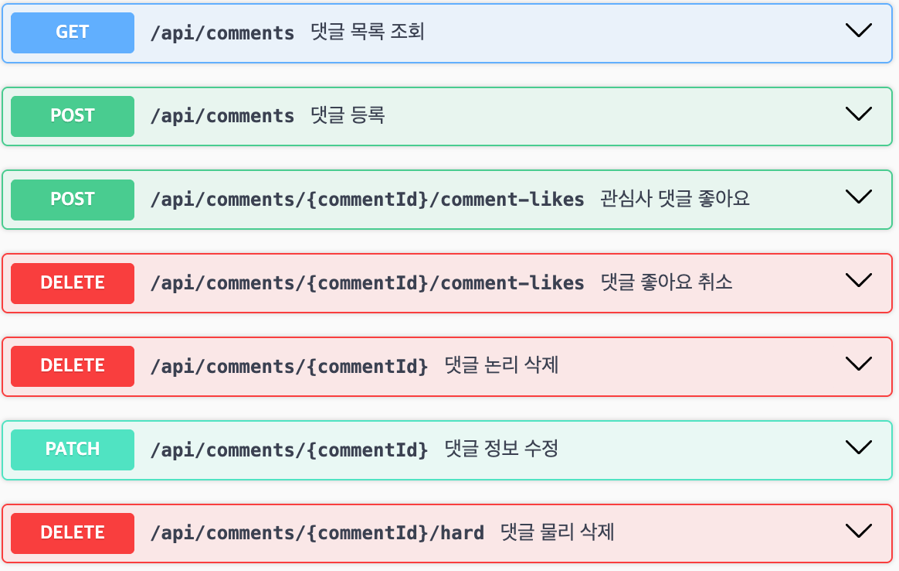

### ✨ 기능

- 댓글 등록 · 목록 조회 · 수정 · 논리 삭제 / 물리 삭제
- 작성자 본인만 수정 가능하도록 권한 검증
- 작성일 · 좋아요 수 기준 정렬 및 Cursor Pagination
- 댓글 좋아요 등록 / 취소 및 중복 좋아요 방지
- 좋아요 수 · 기사 댓글 수 정합성 관리
- 내 댓글에 좋아요가 눌리면 작성자에게 알림 생성

### 💡 구현 포인트

- **좋아요 수 동시성** ([#148](https://github.com/SB14-HJ3S/sb14-monew-team03/pull/148))
    - 20명이 동시에 좋아요를 누르면 좋아요 행은 20개인데 `like_count`는 3으로 남는 갱신 손실을 테스트로 확인
    - 엔티티 값을 읽어 바꾸는 대신 DB에서 `UPDATE ... SET like_count = like_count + 1`로 원자적으로 증감
- **중복 좋아요 방지** ([#148](https://github.com/SB14-HJ3S/sb14-monew-team03/pull/148))
    - 동시 요청이 사전 확인을 함께 통과하는 경우를 `(comment_id, user_id)` 유니크 제약으로 차단
    - 유니크 위반(23505)일 때만 409로 변환하고, 다른 DB 오류는 그대로 전달
- **삭제와 카운트 정합성** ([#254](https://github.com/SB14-HJ3S/sb14-monew-team03/pull/254))
    - 조건부 UPDATE로 동시 삭제 중 한 요청만 성공 처리해 기사 댓글 수가 두 번 줄지 않게 함
    - 물리 삭제 시 좋아요와 좋아요 알림도 함께 삭제
    - `CHECK` 제약으로 좋아요 수 · 댓글 수가 0 아래로 내려가지 않게 DB에서 한 번 더 방어
- **댓글 수정 시 좋아요 수 보존** ([#254](https://github.com/SB14-HJ3S/sb14-monew-team03/pull/254))
    - 수정 시 바뀐 컬럼만 저장해, 동시에 눌린 좋아요 수를 덮어쓰지 않게 함
- **커서 페이지네이션** ([#292](https://github.com/SB14-HJ3S/sb14-monew-team03/pull/292))
    - 마지막 댓글 id를 커서로 쓰고, 정렬 값 → 작성 시각 → id 순으로 비교해 값이 같은 댓글도 누락 · 중복 없이 조회
- **사용자 완전 삭제 시 카운트 정리** ([#302](https://github.com/SB14-HJ3S/sb14-monew-team03/pull/302))
    - 도메인 간 순환 참조를 피하려고 이벤트로 처리하고, 같은 트랜잭션에서 좋아요 수와 기사 댓글 수를 함께 차감
    - 이미 논리 삭제된 댓글은 그때 줄였으므로 차감 대상에서 제외


<p align="right"><a href="#feature-6">⬆️ 맨 위로 (제목을 눌러 접기)</a></p>

</details>

<a id="feature-7"></a>

<details>
<summary><b>알림</b> — 이수찬</summary>
<br>

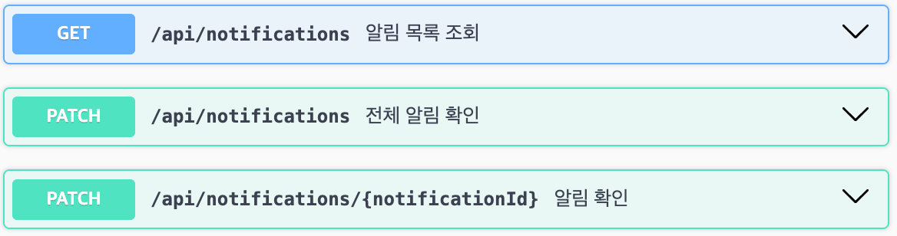

### ✨ 기능

- 구독한 관심사의 새 기사 수집 시 알림 생성
- 내 댓글 좋아요 알림 생성
- 미확인 알림 목록 조회 및 Cursor Pagination
- 단일 / 전체 알림 확인(`confirmed`) 처리
- 확인 후 일정 기간이 지난 알림 배치 자동 삭제

### 💡 구현 포인트

- (프로젝트 진행 후 작성 예정 : 구현 스크린샷 또는 PR/이슈 번호 링크 기재)


<p align="right"><a href="#feature-7">⬆️ 맨 위로 (제목을 눌러 접기)</a></p>

</details>

<a id="feature-8"></a>

<details>
<summary><b>활동 내역</b> — 이수찬</summary>
<br>

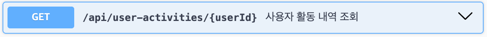

### ✨ 기능

- 구독 중인 관심사 조회
- 최근 작성한 댓글 · 최근 좋아요 누른 댓글 조회
- 최근 본 뉴스 기사 조회
- 댓글 · 좋아요 · 기사 열람 · 구독 내역 통합 응답
- MongoDB 기반 활동 내역 조회 성능 개선(심화)

### 💡 구현 포인트

- (프로젝트 진행 후 작성 예정 : 구현 스크린샷 또는 PR/이슈 번호 링크 기재)


<p align="right"><a href="#feature-8">⬆️ 맨 위로 (제목을 눌러 접기)</a></p>

</details>

<a id="feature-9"></a>

<details>
<summary><b>인프라 · 배포 · 모니터링</b> — 이승현</summary>
<br>

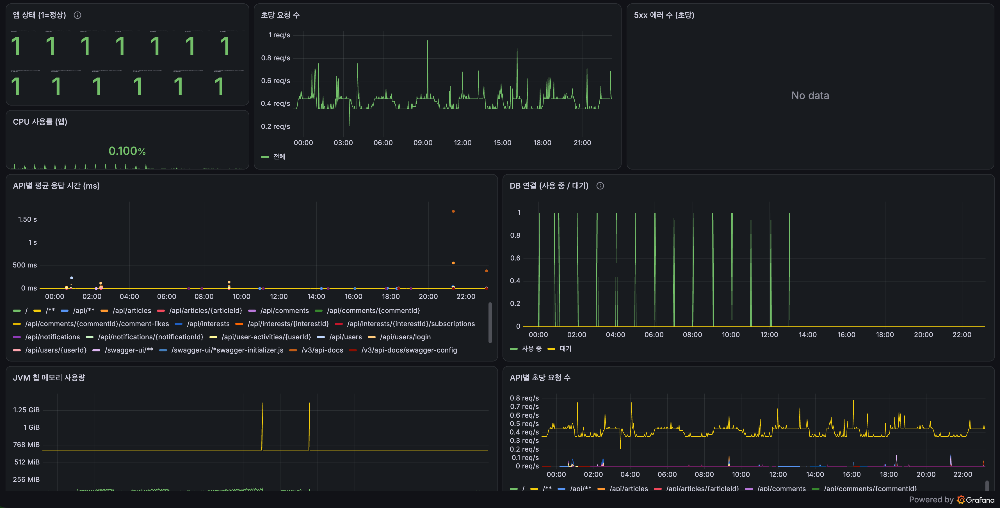

### ✨ 기능

- GitHub Actions 기반 CI(빌드 · 테스트 · 커버리지 리포트)
- Docker 이미지 빌드 및 Amazon ECR 업로드
- Amazon ECS 배포, RDS(PostgreSQL) · S3 연동
- 환경별 설정 분리(local · prod · test)
- Actuator 기반 상태 확인(`/actuator/health`) · Prometheus 지표 수집(`/actuator/prometheus`, 외부 접근 차단)
- Prometheus · Grafana 모니터링 환경 구축

### 💡 구현 포인트

- CI: PR마다 빌드 · 테스트를 자동 실행하고, JaCoCo 커버리지를 Codecov 배지로 표시 (결과 대기 시간 초과 시 직전 값 유지) ([#88](https://github.com/SB14-HJ3S/sb14-monew-team03/pull/88), [#205](https://github.com/SB14-HJ3S/sb14-monew-team03/pull/205))
- 자동 배포: develop 머지 후 CI가 통과하면 Docker 이미지 빌드 → Amazon ECR 업로드 → Amazon ECS 배포까지 GitHub Actions로 자동화 ([#90](https://github.com/SB14-HJ3S/sb14-monew-team03/pull/90))
  <br>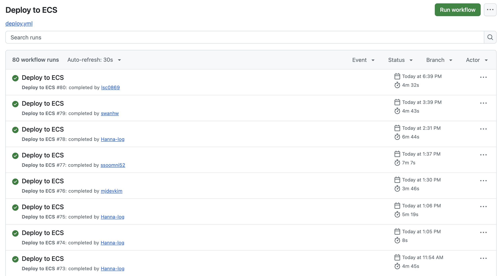
- 모니터링 보안: `/actuator/prometheus`는 외부 접근을 막고 내부 Prometheus만 수집 ([#86](https://github.com/SB14-HJ3S/sb14-monew-team03/pull/86))
- 버전 추적: 모니터링 이미지를 latest 대신 커밋 번호 태그로 배포해, 지금 실행 중인 버전을 바로 확인 ([#251](https://github.com/SB14-HJ3S/sb14-monew-team03/pull/251))
- 트러블슈팅: Prometheus · Grafana 연동이 끊긴 문제 복구 ([#186](https://github.com/SB14-HJ3S/sb14-monew-team03/pull/186)), 운영 컨테이너의 로그 폴더 쓰기 권한 오류 해결 ([#269](https://github.com/SB14-HJ3S/sb14-monew-team03/pull/269))


<p align="right"><a href="#feature-9">⬆️ 맨 위로 (제목을 눌러 접기)</a></p>

</details>

<a id="feature-10"></a>

<details>
<summary><b>공통 (패키지 · 엔티티 설계)</b> — 김민재</summary>

### ✨ 기능

- 헥사고날 패키지 구조 설계
- 도메인별 엔티티 설계

### 💡 구현 포인트

- (프로젝트 진행 후 작성 예정 : 구현 스크린샷 또는 PR/이슈 번호 링크 기재)


<p align="right"><a href="#feature-10">⬆️ 맨 위로 (제목을 눌러 접기)</a></p>

</details>

<a id="feature-11"></a>

<details>
<summary><b>공통 (UseCase · 페이지네이션 · 요청자 ID)</b> — 박수민</summary>

### ✨ 기능

- 도메인별 UseCase · Port 정의
- 커서 페이지네이션
- 요청자 ID 처리

### 💡 구현 포인트

- (프로젝트 진행 후 작성 예정 : 구현 스크린샷 또는 PR/이슈 번호 링크 기재)


<p align="right"><a href="#feature-11">⬆️ 맨 위로 (제목을 눌러 접기)</a></p>

</details>

<a id="feature-12"></a>

<details>
<summary><b>공통 (초기 세팅 · 공통 코드 · 로그 · Swagger)</b> — 이승현</summary>

### ✨ 기능

- 프로젝트 초기 세팅: 개발 환경 · 코드 스타일(Spotless · Checkstyle · IntelliJ), 깃 훅(커밋 메시지 검사 · push 전 검사), 테스트 환경 구성, ArchUnit 패키지 규칙 테스트
- 공통 코드 초기 구성: `BaseEntity` · `BaseSoftDeletableEntity`, JPA Auditing · QueryDSL · 스케줄링 · 비밀번호 암호화 설정, 헤더 상수
- 전역 예외 처리 및 공통 에러 응답: `MonewException` · 도메인별 `ErrorType` · `GlobalExceptionHandler` · `ErrorResponse`
- 로그: 요청별 ID · IP를 로그에 남기는 MDC 추적(비동기 스레드 포함), logback 설정, 콘솔 로그 레벨 색상
- Swagger 설정: `@RequestId` API에 요청자 ID 헤더 자동 추가, 에러 응답 공통 예시
- 그 밖의 공통 설정: API 명세 DTO 반영, 프론트엔드 정적 리소스 · SPA 라우팅, AWS S3 연동, ShedLock 배치 중복 실행 방지

### 💡 구현 포인트

- 초기 세팅: 클론 후 프로젝트만 열면 Spotless · Checkstyle · IntelliJ 코드 스타일, 깃 훅, 테스트 환경이 자동 적용 ([#81](https://github.com/SB14-HJ3S/sb14-monew-team03/pull/81), [#82](https://github.com/SB14-HJ3S/sb14-monew-team03/pull/82))
- 공통 코드 · 예외: `BaseEntity` 등 공통 코드와 `MonewException` · `GlobalExceptionHandler` 기반 공통 에러 응답 구성 ([#83](https://github.com/SB14-HJ3S/sb14-monew-team03/pull/83))
- 요청자 ID: `@RequestId`만 붙이면 Swagger에 요청자 ID 헤더가 자동으로 추가되고, 컨트롤러에서 받는 방식도 하나로 통일 ([#147](https://github.com/SB14-HJ3S/sb14-monew-team03/pull/147))
- 로그 추적: 요청별 ID · IP를 MDC로 남기고 비동기 스레드까지 이어 붙여, 한 요청의 로그를 끝까지 추적 ([#192](https://github.com/SB14-HJ3S/sb14-monew-team03/pull/192))
  <br>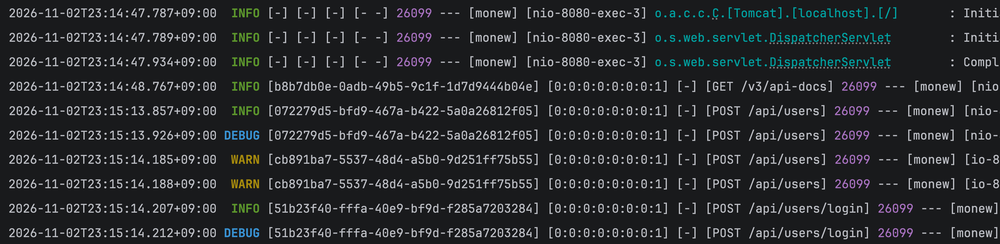
- Swagger 에러 응답: 공통 에러 응답 설정과 `ErrorResponse` 예시값으로 API마다 에러 형식 표시 ([#259](https://github.com/SB14-HJ3S/sb14-monew-team03/pull/259))
- 배치 중복 방지: ShedLock으로 같은 배치가 동시에 두 번 실행되지 않도록 공통 설정 ([#255](https://github.com/SB14-HJ3S/sb14-monew-team03/pull/255))


<p align="right"><a href="#feature-12">⬆️ 맨 위로 (제목을 눌러 접기)</a></p>

</details>

---

## 📌 ERD

PostgreSQL 10개 테이블 + MongoDB 1개 · 모든 테이블 공통 컬럼 `id`(uuid) · `created_at`

<p align="center">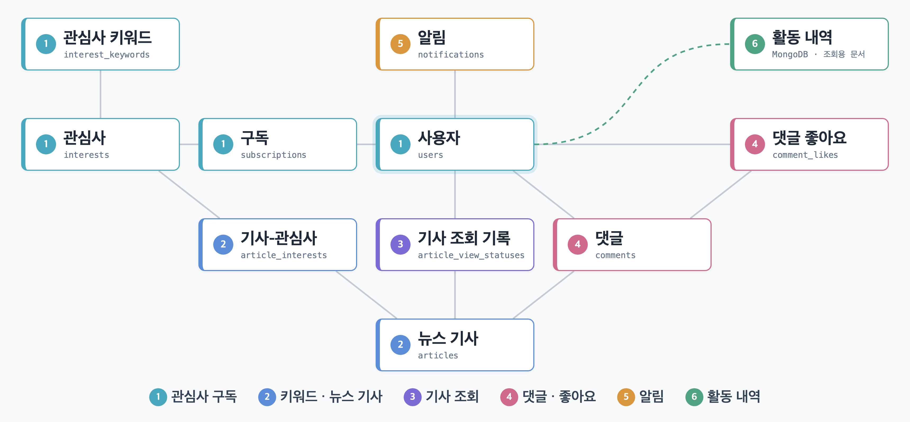</p>

<details>
<summary><b>1. 관심사 구독</b> — <code>interest_keywords · interests · subscriptions · users</code></summary>
<br>

사용자는 여러 관심사를 구독하고, 관심사는 여러 키워드를 가집니다.

<p align="center">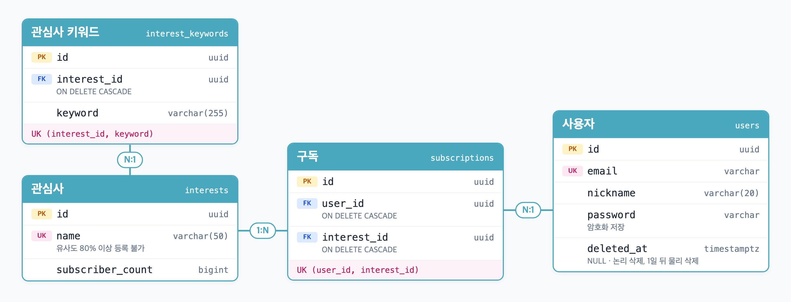</p>

</details>

<details>
<summary><b>2. 키워드 · 뉴스 기사</b> — <code>article_interests · articles</code></summary>
<br>

키워드가 들어간 기사만 저장하고 관심사와 연결합니다. 같은 기사(원본 링크)는 중복 저장하지 않습니다.

<p align="center">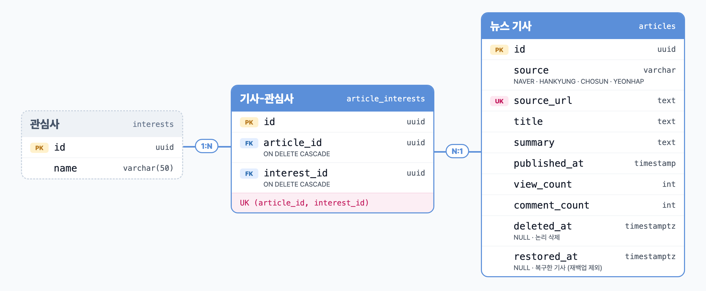</p>

</details>

<details>
<summary><b>3. 기사 조회</b> — <code>article_view_statuses</code></summary>
<br>

사용자별 기사 조회 기록입니다. 같은 기사는 한 번만 기록합니다.

<p align="center">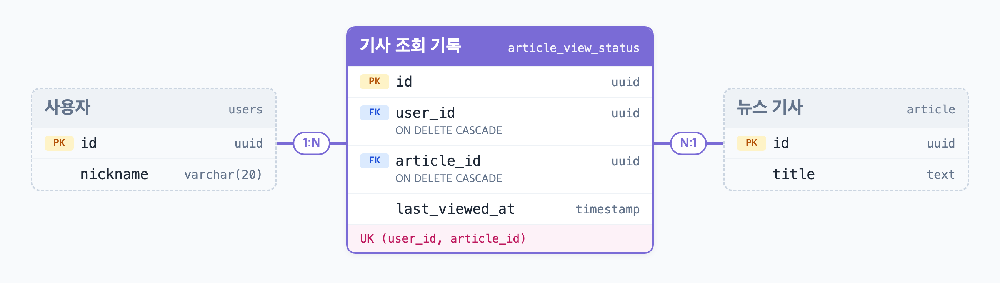</p>

</details>

<details>
<summary><b>4. 댓글 · 좋아요</b> — <code>comments · comment_likes</code></summary>
<br>

댓글과 댓글 좋아요입니다. 좋아요는 댓글당 한 번만 누를 수 있습니다.

<p align="center">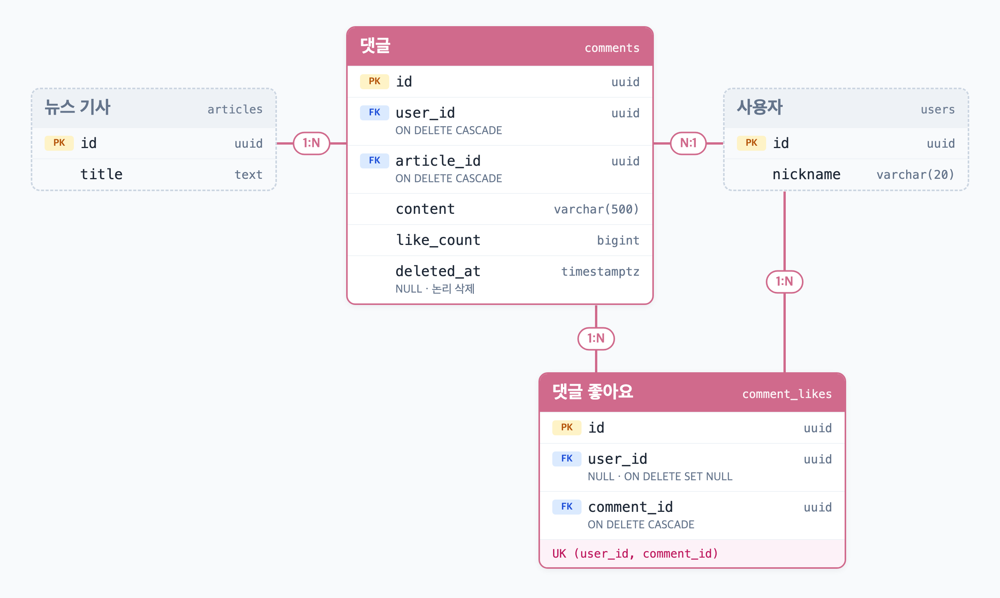</p>

</details>

<details>
<summary><b>5. 알림</b> — <code>notifications</code></summary>
<br>

사용자별 알림입니다. 확인한 알림은 7일 뒤 삭제됩니다.

<p align="center">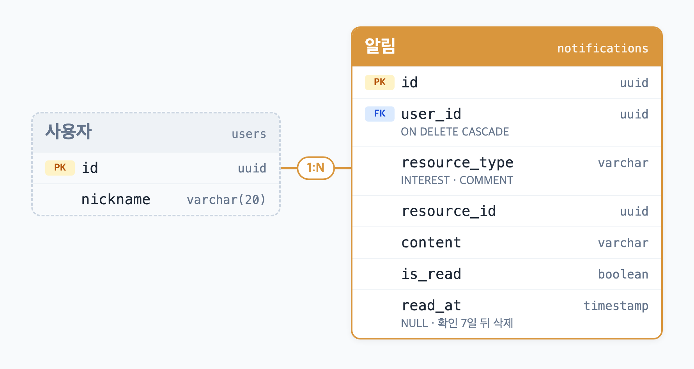</p>

</details>

<a id="erd-activity"></a>

<details>
<summary><b>6. 활동 내역</b> — <code>user_activities</code> (MongoDB)</summary>
<br>

사용자 1명당 문서 1건으로, 조인 없이 한 번에 조회하도록 활동 내역을 미리 모아 둔 조회용 문서입니다.

<p align="center">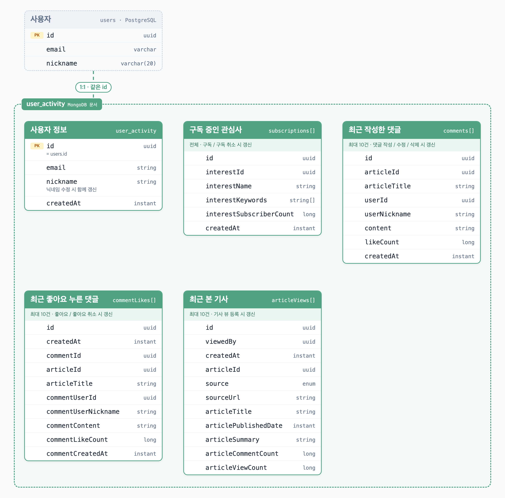</p>

> MongoDB는 테이블을 FK로 잇지 않아서 ERD 대신 문서 구조로 표시했습니다. 필드는 활동 내역 API 응답(`UserActivityDto`) 기준입니다.


<p align="right"><a href="#erd-activity">⬆️ 맨 위로 (6. 활동 내역을 눌러 접기)</a></p>

</details>

---

## 📌 주요 처리 흐름 (최종 구현 후 수정 예정)

<details>
<summary><b>1. 요청자 확인</b></summary>
<br>

```text
API 요청 (헤더: Monew-Request-User-ID)
   ↓
RequestIdInterceptor
   ↓   @RequestId가 붙은 API만
헤더 값을 UUID로 확인
   ↓
RequestIdContext에 요청자 ID 저장
   ↓
서비스에서 요청자 ID를 꺼내 사용
   ↓   요청이 끝나면
RequestIdContext 비우기
```

- **@RequestId**: 요청자가 필요한 API에만 붙이는 표시. Swagger에도 헤더 입력칸이 자동으로 생김
- **잘못된 헤더**: 비어 있거나 UUID 형식이 아니면 400 에러
- **RequestIdContext**: 요청마다 따로 쓰는 저장 공간(ThreadLocal)이라 다른 사람의 요청과 섞이지 않음

</details>

<details>
<summary><b>2. 관심사 유사 이름 검사</b></summary>
<br>

```text
관심사 등록 요청 (이름 · 키워드)
   ↓
이름 정규화 (공백 제거 · 소문자 · 한글 자모 분리)
   ↓
기존 관심사 이름과 유사도 계산 (레벤슈타인 거리)
   ↓
80% 이상 비슷하면 등록 불가 (409)
   ↓   아니면
관심사 · 키워드 저장
```

- **유사도**: 두 이름을 같게 만들려면 몇 글자를 고쳐야 하는지로 계산
- **자모 분리**: "트렌드"와 "트랜드"처럼 한 글자 안의 모음만 달라도 차이를 잡아냄
- **예시**: 기존 "AI 트렌드"가 있으면 "AI 트랜드"는 등록 불가

</details>

<details>
<summary><b>3. 뉴스 기사 자동 수집</b></summary>
<br>

```text
매시간 정각 Spring Batch 수집 Job 실행 (@Scheduled + ShedLock)
   ↓
구독 중인 관심사 · 키워드 조회
   ↓
네이버 뉴스 API · 언론사 RSS 기사 수집
   ↓
키워드가 들어간 기사만 선별
   ↓
원본 URL 기준 중복 제거
   ↓
관심사별 기사 저장
   ↓   새 기사가 있으면
구독자에게 알림 생성
```

- **ShedLock**: 배포 중 앱이 2개 떠 있어도 한 번만 실행
- **언론사 RSS**: 한국경제 · 조선일보 · 연합뉴스
- **관심사별 저장**: 한 관심사가 실패해도 다음 관심사는 계속 수집
- **알림 생성**: `ArticlesSavedEvent` 발행 → 커밋 후 비동기로 생성

</details>

<details>
<summary><b>4. 댓글 좋아요 → 알림</b></summary>
<br>

```text
댓글 좋아요 등록
        ↓
CommentLikedEvent 발행
        ↓
Transaction COMMIT
        ↓
@TransactionalEventListener(AFTER_COMMIT) + @Async
        ↓
댓글 작성자에게 Notification 생성
```

</details>

<details>
<summary><b>5. 사용자 활동 내역 (구현 후 수정 예정)</b></summary>
<br>

```text
댓글 · 좋아요 · 기사 열람 · 구독 발생
        ↓
활동 이벤트 발행
        ↓
MongoDB 사용자 활동 문서 갱신
        ↓
활동 내역 조회 시 문서 1건으로 응답
```

</details>

<details>
<summary><b>6. 논리 삭제 → 물리 삭제 (구현 후 수정 예정)</b></summary>
<br>

```text
삭제 요청
   ↓
논리 삭제 (삭제 시각만 기록)
   ↓   이때부터 조회 · 목록에서 제외, 데이터는 유지
물리 삭제
   ↓
관련 데이터도 함께 삭제
```

| 도메인 | 물리 삭제 시점 | 함께 삭제되는 관련 데이터 |
|---|---|---|
| **사용자** | 논리 삭제 후 1일 지나면 배치가 자동 삭제 | 구독 · 댓글 · 좋아요 · 알림 · 기사 조회 기록 (구독자 수도 정리) |
| **뉴스 기사** | 물리 삭제 API (`/hard`) | 댓글 · 댓글 좋아요 · 좋아요 알림 · 기사-관심사 연결 · 조회 기록 |
| **댓글** | 물리 삭제 API (`/hard`) | 좋아요 (기사의 댓글 수도 정리) |

- **논리 삭제가 기본**: 관련 정보가 남아 있도록 바로 지우지 않음
- **사용자 물리 삭제**: `UserHardDeletingEvent`를 발행해서, 사용자 도메인이 다른 도메인 코드를 직접 부르지 않고 이벤트로 정리를 맡김
- **기사 · 댓글 물리 삭제**: 화면(UI)에는 없고 API와 테스트 코드로 검증

</details>

<details>
<summary><b>7. 데이터 정리 배치 (구현 후 수정 예정)</b></summary>
<br>

```text
매일 새벽 3시                          매시간 정각
   ↓                                    ↓
확인 후 7일 지난 알림 조회              논리 삭제 후 1일 지난 사용자 조회
   ↓                                    ↓
알림 삭제                               사용자와 관련 데이터 물리 삭제
```

</details>

<details>
<summary><b>8. 기사 백업 · 복구 (구현 후 수정 예정)</b></summary>
<br>

**백업**

```text
매일 0시 Spring Batch 실행
   ↓
전날 저장된 기사 조회 (1,000건씩)
   ↓
JSON 직렬화 + gzip 압축
   ↓
Amazon S3 업로드 (날짜별 · 파트별 .json.gz 파일)
```

**복구**

```text
복구 요청 (날짜 범위)
   ↓
S3 백업 파일 조회
   ↓
DB에 없는 기사 선별
   ↓
유실 기사만 복원
```

</details>

<details>
<summary><b>9. CI/CD</b></summary>
<br>

```text
PR 생성
   ↓
CI 검사 + 자동 리뷰
   ↓   CI 통과 · 리뷰 승인
develop 머지
   ↓   develop CI 성공 시 자동 배포
Docker 이미지 빌드
   ↓   OIDC로 AWS 인증
Amazon ECR 업로드
   ↓
Amazon ECS 무중단 배포
```

- **CI 검사 (GitHub Actions)**: 빌드 · 테스트, Checkstyle · ArchUnit 패키지 규칙, JaCoCo 커버리지 → Codecov
- **자동 리뷰**: CodeRabbit · Claude Code
- **OIDC 인증**: GitHub Actions에 AWS 키를 저장하지 않고, 배포할 때만 잠깐 쓰는 권한을 받음
- **무중단 배포**: 새 버전이 정상으로 뜬 뒤에 옛 버전 종료

</details>

---

<a id="deploy"></a>

## 📌 배포 구조

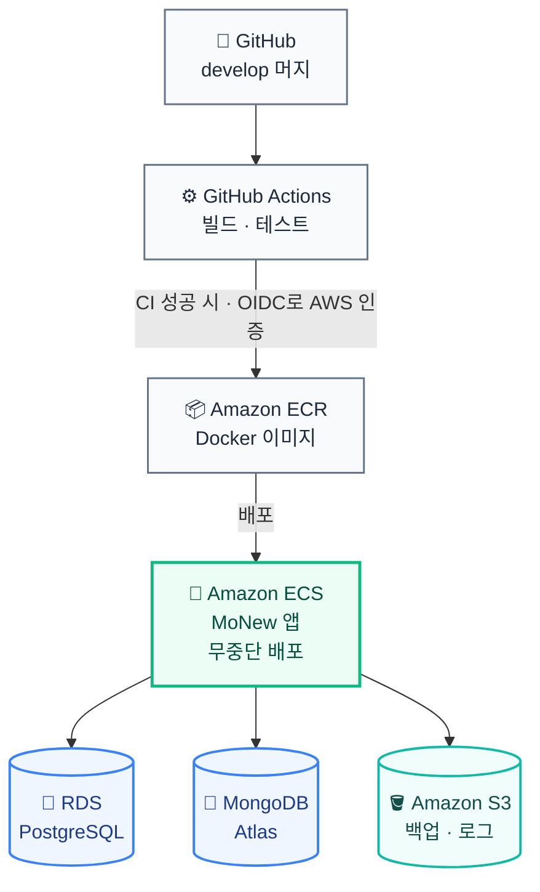

<details>
<summary>[자세히 보기]</summary>
<br>

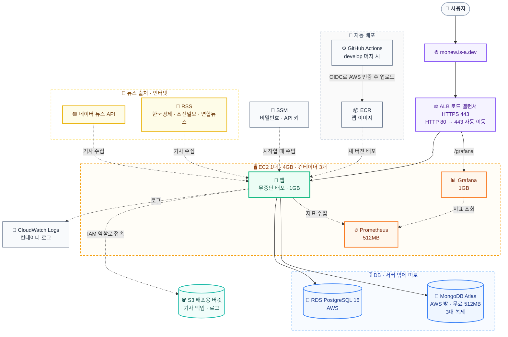


<p align="right"><a href="#deploy">⬆️ 맨 위로 (자세히 보기를 눌러 접기)</a></p>

</details>

---

<a id="test-quality"></a>

## 📌 테스트 및 품질 관리

<details>
<summary>[펼쳐보기]</summary>
<br>

### CI

`main` · `develop`으로 가는 Pull Request와 `develop` 머지(push) 때
GitHub Actions CI가 실행됩니다. (문서 · 프론트엔드 정적 파일만 바뀐 경우는 빌드 생략)

```bash
./gradlew build
```

**검증 및 리포트 항목**

- 전체 테스트 실행, 줄 커버리지 80% 미만이면 빌드 실패 (DTO · 설정 클래스 등 제외)
- JaCoCo 커버리지 리포트 생성 → Codecov 업로드 · 결과 확인
- Checkstyle 코드 스타일 검사 (경고만, PR에서 바뀐 줄 기준)
- ArchUnit 패키지 규칙 검사 (헥사고날 계층 · 순환 참조, 경고만)
- 결과를 PR 댓글로 알림 (테스트 실패 · 커버리지 · 규칙 위반)

> 테스트는 Testcontainers로 실제 PostgreSQL·MongoDB 컨테이너를 띄워 실행합니다 (Docker 필요).

### PR 자동 리뷰

- CodeRabbit · Claude Code가 PR마다 코드를 리뷰하고, 지적 사항을 🔴 필수 · 🟠 권장 · 🟡 선택으로 나눠 남깁니다

### 로컬 테스트 실행

```bash
# macOS / Linux
./gradlew clean test jacocoTestReport

# Windows
.\gradlew.bat clean test jacocoTestReport
```

| 산출물 | 경로 |
| :--- | :--- |
| 테스트 결과 | `build/reports/tests/test/index.html` |
| JaCoCo HTML | `build/reports/jacoco/test/html/index.html` |
| JaCoCo XML | `build/reports/jacoco/test/jacocoTestReport.xml` |


<p align="right"><a href="#test-quality">⬆️ 맨 위로 (펼쳐보기를 눌러 접기)</a></p>

</details>

---

<a id="dev-rules"></a>

## 📌 개발 규칙

> 자세한 컨벤션은 [팀 Notion](https://app.notion.com/p/8949e310974382de9473015def3c352b)을 참고합니다.

<details>
<summary>[펼쳐보기]</summary>
<br>

| 구분 | 규칙 |
| :--- | :--- |
| 브랜치 전략 | `{타입}/{이슈번호}-{작업명}` → `develop` → `main` (예: `feat/12-interest-subscribe`) — 이슈의 Branch Keyword 칸에 작업명을 적으면 브랜치가 자동으로 생성됨 |
| 커밋 컨벤션 | `타입 : 작업 내용 [#이슈번호]` (예: `feat : 관심사 구독 API 추가 [#12]`) — 이슈 번호는 브랜치 이름에서 자동으로 붙음, TDD 단계는 `test(red)` · `feat(green)` · `refactor(blue)` (단축키 `t1` · `f1` · `r1`), 리뷰 반영 커밋은 제목 끝에 `;c` · `;r` |
| PR 규칙 | 이슈 연결(`close #이슈번호`) · 리뷰 승인 1명 이상 후 **일반 머지가 기본**(TDD 단계 커밋을 develop에 그대로 남김) |
| 코드 스타일 | Spotless(google-java-format `aosp()`, 들여쓰기 4칸) — 커밋 시 Git Hook으로 자동 적용, **최종 포맷 기준**. push 전에는 포맷 검사 · 컴파일을 한 번 더 확인 |
| 협업 자동화 | PR 제목 · 라벨 자동 정리, 이슈 · PR · 리뷰 디스코드 알림, 프로젝트 보드 상태 자동 변경 |
| 기본 에디터 설정 | `.editorconfig` — 인코딩(UTF-8)·줄바꿈(LF)·줄 끝 공백 제거 등을 에디터 종류와 무관하게 통일 (IntelliJ 포함 대부분의 에디터가 자동 인식) |
| 저장 시 자동 포맷팅 | 인텔리제이를 **닫은 상태**에서 `./gradlew installIntellijActionsOnSave` 1회 실행 (Java 파일 저장할 때마다 리포맷 + import 정리 — 편의용이며, 커밋 시 Spotless가 다시 한 번 기준에 맞춰 정리함) |


<p align="right"><a href="#dev-rules">⬆️ 맨 위로 (펼쳐보기를 눌러 접기)</a></p>

</details>

---

<a id="local-setup"></a>

## 📌 로컬 개발 환경 구동 방법

> IntelliJ 설정까지 포함한 단계별 안내는 [SETUP.md](./SETUP.md)에 있습니다.

<details>
<summary>[펼쳐보기]</summary>
<br>

**요구사항**

- JDK 17
- Docker Desktop (실행 중이어야 함)

**1. 저장소 받기**

```bash
git clone https://github.com/SB14-HJ3S/sb14-monew-team03.git
cd sb14-monew-team03
```

**2. 환경 변수**

`.env.example`을 복사해 `.env`를 만들고 값을 채웁니다.

```bash
cp .env.example .env
```

| 값 | 용도 |
| :--- | :--- |
| `AWS_ACCESS_KEY_ID` · `AWS_SECRET_ACCESS_KEY` · `AWS_S3_BUCKET` | 로컬에서 S3 기능(기사 백업 · 복구, 로그 적재) 테스트용 — 로컬 전용 버킷 |
| `NAVER_API_CLIENT_ID` · `NAVER_API_CLIENT_SECRET` | 뉴스 수집용 네이버 API 키 |

> 비밀값은 저장소에 커밋하지 않습니다. (`.env`는 `.gitignore`에 등록)<br>
> 로컬 DB 접속 정보는 `compose.yaml`에 고정돼 있어서 `.env`에 적지 않습니다.

**(선택) direnv로 쉘에도 자동 연동**

`.env`는 스프링 앱에만 읽히므로, 터미널에서 `aws` CLI 등 외부 명령어도 같은 값으로 쓰려면 [direnv](https://direnv.net/)를 추가로 설정합니다. 저장소의 `.envrc`가 `.env`를 자동으로 불러옵니다.

```bash
brew install direnv
# 쉘 설정 파일(.zshrc 등)에 추가 후 터미널 재시작
echo 'eval "$(direnv hook zsh)"' >> ~/.zshrc
direnv allow   # 프로젝트 폴더에서 한 번만 실행
```

**3. 로컬 인프라**

앱을 실행하면 `compose.yaml`의 DB · 모니터링 컨테이너가 자동으로 같이 뜹니다. 직접 띄우려면:

```bash
docker compose up -d
```

| 서비스 | 주소 |
| :--- | :--- |
| PostgreSQL 16 | `localhost:5432` (DB `monew`) |
| MongoDB 7 | `localhost:27017` (DB `monew`) |
| Prometheus | `localhost:9090` |
| Grafana | `localhost:3000` |

**4. 애플리케이션 실행**

```bash
# macOS / Linux
./gradlew bootRun

# Windows
.\gradlew.bat bootRun
```

| 대상 | 주소 |
| :--- | :--- |
| 웹 화면 | http://localhost:8080 |
| Swagger UI | http://localhost:8080/swagger-ui/index.html |
| OpenAPI JSON | http://localhost:8080/v3/api-docs |
| 서버 상태 | http://localhost:8080/actuator/health |

**5. 테스트**

```bash
./gradlew test
```

> 테스트는 Testcontainers(PostgreSQL · MongoDB)로 실행되며, 커버리지 리포트(JaCoCo)가 함께 생성됩니다. Docker Desktop을 켜 두세요.

**6. 종료**

```bash
docker compose down
```

> 로컬 데이터까지 지워야 할 때만 `docker compose down --volumes`를 실행합니다.


<p align="right"><a href="#local-setup">⬆️ 맨 위로 (펼쳐보기를 눌러 접기)</a></p>

</details>

---

## 📌 프로젝트 패키지 전체 구조 살펴보기 (4번 최종 구현 후 수정 예정)

### 1. 전체 구성 (간단.Ver)

```text
sb14-monew-team03/
├── .github/          # 이슈 · PR 템플릿, CI · 배포 · 협업 자동화 워크플로
├── .githooks/        # 커밋 메시지 검사 · push 전 검사
├── config/           # Checkstyle · IntelliJ 코드 스타일
├── docs/             # README 이미지 · 문서
├── monitoring/       # Prometheus · Grafana 설정
├── scripts/          # 커밋 전 Spotless 자동 정리 (Git Hook)
├── src/
│   ├── main/
│   │   ├── java/com/sprint/monew/   # 백엔드 소스 (헥사고날, 자세한 구성은 아래 2번)
│   │   │   ├── adapter/             # 바깥 연결: 컨트롤러 · 배치(스케줄러 포함) · 이벤트 리스너 · DB · 네이버/RSS
│   │   │   ├── application/         # 도메인별 기능: user · interest · article · comment · notification · useractivity
│   │   │   ├── domain/              # 엔티티 · enum · 도메인 이벤트
│   │   │   └── global/              # 공통: 설정 · 예외 · 페이지네이션 · 로깅
│   │   └── resources/               # 설정 파일 · 프론트엔드 빌드 결과물
│   └── test/                        # 테스트 코드
├── build.gradle      # 의존성 · 빌드 설정
├── compose.yaml      # 로컬 PostgreSQL · MongoDB · Prometheus · Grafana 컨테이너
├── Dockerfile        # 배포 이미지
├── .env.example      # 환경 변수 예시
├── SETUP.md          # 처음 세팅 안내
└── README.md         # 프로젝트 소개
```

### 2. 계층 구성 (간단.Ver) — 헥사고날 · 뉴스 기사 예시

```text
src/main/java/com/sprint/monew
├── adapter/                                      # 바깥과 연결
│   ├── in/                                       # 들어오는 요청
│   │   ├── controller/article/
│   │   │   ├── ArticleController                 # 기사 API
│   │   │   ├── ArticleCollectionManualController # 기사 수집 수동 실행 API
│   │   │   └── dto/response/                     # ArticleDto · ArticleViewDto · ArticleRestoreResultDto
│   │   ├── scheduler/
│   │   │   └── ArticleCollectionScheduler        # 정해진 시각에 수집 실행 (@Scheduled)
│   │   └── batch/
│   │       └── ArticleCollectionRunner           # 기사 수집 실행기
│   └── out/article/                              # 나가는 연결 (Port 구현)
│       ├── ArticleRepositoryAdapter              # ArticleRepositoryPort 구현
│       ├── ArticleJpaRepository                  # Spring Data JPA
│       ├── ArticleQueryRepository(Impl)          # 검색 · 필터 · 정렬 동적 쿼리 (QueryDSL)
│       ├── ArticleInterestRepositoryAdapter      # 기사-관심사 연결 저장 (+ JpaRepository)
│       ├── ArticleViewStatusRepositoryAdapter    # 기사 조회 기록 저장 (+ JpaRepository)
│       ├── ArticleEventPublisherAdapter          # 이벤트 발행
│       ├── naver/                                # NaverNewsAdapter · NaverNewsMapper · NaverNewsResponse
│       └── rss/                                  # RssNewsAdapter · RssNewsMapper
├── application/article/                          # 기능 흐름
│   ├── provided/                                 # 밖에 제공
│   │   ├── ArticleUseCase                        # 기사 조회 · 뷰 · 출처 · 삭제 · 복구
│   │   ├── ArticleCollectionUseCase              # 기사 수집
│   │   └── dto/                                  # ArticleQuery · ArticleResult · SourceResult · CollectedArticle
│   ├── required/                                 # 밖에 요청 (Port)
│   │   ├── ArticleRepositoryPort                 # 기사 저장소
│   │   ├── ArticleInterestRepositoryPort         # 기사-관심사 연결 저장소
│   │   ├── ArticleViewStatusRepositoryPort       # 기사 조회 기록 저장소
│   │   ├── ArticleEventPublisherPort             # 이벤트 발행
│   │   └── NaverNewsPort · RssNewsPort           # 외부 뉴스 수집
│   ├── event/                                    # ArticlesSavedEvent · ArticleSoftDeletedEvent · ArticleHardDeletingEvent
│   ├── ArticleApplication                        # ArticleUseCase 구현
│   ├── ArticleCollectionApplication              # ArticleCollectionUseCase 구현
│   └── ArticleService · ArticleInterestService · ArticleViewStatusService (+ Impl)  # 도메인 서비스
├── domain/article/entity/                        # Article · ArticleInterest · ArticleViewStatus
└── global/                                       # 공통: 설정 · 예외(ArticleErrorType) · 타입(ArticleSourceType) · 페이지네이션 · 요청자 ID · 로깅
```

> 요청 흐름: `ArticleController` → `ArticleUseCase`(구현 `ArticleApplication`) → `ArticleService` → `ArticleRepositoryPort`(구현 `ArticleRepositoryAdapter`) → DB
> 다른 도메인(`user` · `interest` · `comment` · `notification` · `useractivity`)도 같은 구조입니다.

| 도메인 · 기능 | 담당 |
| :--- | :--- |
| `user` | 사용자 (이승현) |
| `interest` | 관심사 · 구독 (박수민) |
| `article` | 뉴스 기사 수집 · 조회 · 백업 (김민재) |
| `article` | 뉴스 기사 출처 목록 · 논리 · 물리 삭제 (이승현) |
| `comment` | 댓글 · 좋아요 (정수환) |
| `notification` · `useractivity` | 알림 · 사용자 활동 내역 (이수찬) |
| `batch` | 배치 (박수민) |
| `.github/workflows` · `Dockerfile` · `monitoring` | 배포 · 인프라 (이승현) |

> 컨트롤러는 UseCase만 부르고, 저장소는 Port(인터페이스) 뒤에 숨겨서 계층끼리 직접 의존하지 않게 합니다.

<a id="pkg-global"></a>

### 3. 공통 영역 (global) (상세.Ver)

<details>
<summary>[펼쳐보기]</summary>
<br>

```text
src/main/java/com/sprint/monew/global/
├── annotation/
│   ├── ApplicationService                          # Application 계층 표시 (@Service + @Validated)
│   ├── RequestId                                   # 요청자 ID가 필요한 API 표시
│   └── RestWebAdapter                              # 컨트롤러 표시 (@RestController)
├── config/                                         # 설정
│   ├── AsyncConfig                                 # @Async 비동기 실행 (MDC 복사 포함)
│   ├── JpaAuditingConfig                           # 생성 · 수정 시각 자동 기록
│   ├── PasswordEncoderConfig                       # 비밀번호 암호화
│   ├── QueryDslConfig                              # QueryDSL (JPAQueryFactory)
│   ├── S3Config                                    # S3 클라이언트
│   ├── S3Properties                                # S3 버킷 · 리전 설정 값
│   ├── SchedulingConfig                            # @Scheduled 켜기
│   ├── ScheduledLockAspect                         # @Scheduled 중복 실행 방지 (ShedLock)
│   ├── ShedLockConfig                              # ShedLock 잠금 저장소
│   ├── SwaggerConfig                               # Swagger 문서 · 요청자 ID 헤더 칸
│   └── WebMvcConfig                                # 인터셉터 · 변환기 등록
├── constant/
│   └── MonewHeaders                                # 헤더 이름 상수 (Monew-Request-User-ID 등)
├── context/
│   └── RequestIdContext                            # 요청자 ID 저장 (ThreadLocal)
├── entity/
│   ├── BaseEntity                                  # id · 생성 시각
│   └── BaseSoftDeletableEntity                     # 논리 삭제 시각 포함
├── exception/
│   ├── ErrorResponse                               # 에러 응답 형식
│   ├── ErrorType                                   # 에러 종류 규격 (도메인별 enum이 구현)
│   ├── GlobalExceptionHandler                      # 전역 예외 처리
│   ├── MonewException                              # 공통 예외
│   └── errortype/                                  # 도메인별 ErrorType
│       ├── ArticleErrorType
│       ├── CommentErrorType
│       ├── CommonErrorType
│       ├── ExternalErrorType                       # 외부 API 오류
│       ├── InterestErrorType
│       ├── NotificationErrorType
│       ├── SubscriptionErrorType
│       └── UserErrorType
├── logging/
│   ├── LogLevelHighlightConverter                  # 콘솔 로그 레벨 색상
│   ├── MdcLoggingFilter                            # 요청별 ID · IP를 로그에 기록 (MDC)
│   └── MdcTaskDecorator                            # @Async 스레드로 MDC 복사
├── pagination/                                     # 커서 페이지네이션
│   ├── PageQuery                                   # 커서 · 크기
│   ├── PageResult                                  # 페이지 결과
│   ├── SortDirection                               # ASC · DESC
│   ├── SortOrder                                   # 정렬 기준 규격
│   └── SortedPageQuery                             # 정렬 포함 페이지 요청
├── type/
│   ├── ArticleSourceType                           # 기사 출처 (네이버 · 한국경제 · 조선일보 · 연합뉴스)
│   └── ResourceType                                # 알림 대상 종류 (관심사 · 댓글)
├── util/
│   ├── DatabaseConstraintUtils                     # DB 제약 조건 위반 확인
│   └── similarity/
│       └── StringSimilarityUtils                   # 관심사 이름 유사도 계산
└── web/
    ├── ActuatorAccessFilter                        # /actuator/prometheus 외부 접근 차단
    ├── RequestIdInterceptor                        # 요청자 ID 헤더 확인
    ├── SpaForwardController                        # 프론트 화면 주소 새로고침 시 404 방지
    └── StringToSortOrderConverterFactory           # 정렬 파라미터 문자열 → 정렬 기준 변환
```

<p align="right"><a href="#pkg-global">⬆️ 맨 위로 (펼쳐보기를 눌러 접기)</a></p>

</details>

<a id="pkg-all"></a>

### 4. 전체 패키지 구성 (상세.Ver) (구현 후 수정 예정)

<details>
<summary>[펼쳐보기]</summary>
<br>

```text
src/main/java/com/sprint/monew/
├── MonewApplication                                # 애플리케이션 시작점
├── adapter/                                        # 바깥과 연결하는 계층
│   ├── in/                                         # 들어오는 요청
│   │   ├── batch/                                  # 배치 실행기
│   │   │   ├── ArticleCollectionRunner
│   │   │   ├── NotificationCleanupRunner
│   │   │   └── log/                                # 로그 S3 적재 배치 (Spring Batch) (박수민)
│   │   │       ├── LogBackupFailedException
│   │   │       ├── LogBackupJobConfig
│   │   │       ├── LogBackupScheduler
│   │   │       ├── LogBackupStepListener
│   │   │       ├── LogBackupTasklet
│   │   │       └── LogMetrics
│   │   ├── controller/                             # API 컨트롤러
│   │   │   ├── article/                            # 뉴스 기사 (김민재, 이승현)
│   │   │   │   ├── ArticleCollectionManualController
│   │   │   │   ├── ArticleController
│   │   │   │   └── dto/                            # 요청 / 응답 DTO
│   │   │   │       └── response/                   # 응답 DTO
│   │   │   │           ├── ArticleDto
│   │   │   │           ├── ArticleRestoreResultDto
│   │   │   │           └── ArticleViewDto
│   │   │   ├── comment/                            # 댓글 · 좋아요 (정수환)
│   │   │   │   ├── CommentController
│   │   │   │   └── dto/                            # 요청 / 응답 DTO
│   │   │   │       ├── request/                    # 요청 DTO
│   │   │   │       │   ├── CommentRegisterRequest
│   │   │   │       │   └── CommentUpdateRequest
│   │   │   │       └── response/                   # 응답 DTO
│   │   │   │           ├── CommentDto
│   │   │   │           ├── CommentLikeDto
│   │   │   │           └── CursorPageResponseCommentDto
│   │   │   ├── interest/                           # 관심사 · 구독 (박수민)
│   │   │   │   ├── InterestController
│   │   │   │   └── dto/                            # 요청 / 응답 DTO
│   │   │   │       ├── request/                    # 요청 DTO
│   │   │   │       │   ├── InterestRegisterRequest
│   │   │   │       │   └── InterestUpdateRequest
│   │   │   │       └── response/                   # 응답 DTO
│   │   │   │           ├── CursorPageResponseInterestDto
│   │   │   │           ├── InterestDto
│   │   │   │           └── SubscriptionDto
│   │   │   ├── notification/                       # 알림 (이수찬)
│   │   │   │   ├── NotificationController
│   │   │   │   └── dto/                            # 요청 / 응답 DTO
│   │   │   │       └── response/                   # 응답 DTO
│   │   │   │           ├── CursorPageResponseNotificationDto
│   │   │   │           └── NotificationDto
│   │   │   ├── user/                               # 사용자 (이승현)
│   │   │   │   ├── UserController
│   │   │   │   └── dto/                            # 요청 / 응답 DTO
│   │   │   │       ├── request/                    # 요청 DTO
│   │   │   │       │   ├── UserLoginRequest
│   │   │   │       │   ├── UserRegisterRequest
│   │   │   │       │   └── UserUpdateRequest
│   │   │   │       └── response/                   # 응답 DTO
│   │   │   │           └── UserDto
│   │   │   └── useractivity/                       # 사용자 활동 내역 (이수찬)
│   │   │       ├── UserActivityController
│   │   │       └── dto/                            # 요청 / 응답 DTO
│   │   │           └── response/                   # 응답 DTO
│   │   │               ├── ArticleViewActivityDto
│   │   │               ├── CommentActivityDto
│   │   │               ├── CommentLikeActivityDto
│   │   │               ├── SubscriptionActivityDto
│   │   │               └── UserActivityDto
│   │   ├── event/                                  # 이벤트 리스너
│   │   │   ├── interest/                           # 관심사 · 구독 (박수민)
│   │   │   │   └── InterestEventListener
│   │   │   └── notification/                       # 알림 (이수찬)
│   │   │       └── NotificationEventListener
│   │   └── scheduler/                              # 정해진 시각에 실행 (@Scheduled)
│   │       ├── ArticleCollectionScheduler
│   │       └── NotificationCleanupScheduler
│   └── out/                                        # 나가는 연결 (저장소 · 외부 API · 이벤트 발행)
│       ├── article/                                # 뉴스 기사 (김민재, 이승현)
│       │   ├── ArticleEventPublisherAdapter
│       │   ├── ArticleInterestJpaRepository
│       │   ├── ArticleInterestRepositoryAdapter
│       │   ├── ArticleJpaRepository
│       │   ├── ArticleQueryRepository
│       │   ├── ArticleQueryRepositoryImpl
│       │   ├── ArticleRepositoryAdapter
│       │   ├── ArticleViewStatusJpaRepository
│       │   ├── ArticleViewStatusRepositoryAdapter
│       │   ├── naver/                              # 네이버 뉴스 API 수집
│       │   │   ├── NaverNewsAdapter
│       │   │   ├── NaverNewsMapper
│       │   │   └── NaverNewsResponse
│       │   └── rss/                                # 언론사 RSS 수집
│       │       ├── RssNewsAdapter
│       │       └── RssNewsMapper
│       ├── comment/                                # 댓글 · 좋아요 (정수환)
│       │   ├── CommentEventPublisherAdapter
│       │   ├── CommentJpaRepository
│       │   ├── CommentLikeJpaRepository
│       │   ├── CommentLikeRepositoryAdapter
│       │   └── CommentRepositoryAdapter
│       ├── interest/                               # 관심사 · 구독 (박수민)
│       │   ├── InterestAnchor
│       │   ├── InterestJpaRepository
│       │   ├── InterestQueryRepository
│       │   ├── InterestQueryRepositoryImpl
│       │   ├── InterestRepositoryAdapter
│       │   ├── SubscriptionJpaRepository
│       │   └── SubscriptionRepositoryAdapter
│       ├── log/                                    # 로그 S3 적재 (박수민)
│       │   └── S3LogStorageAdapter
│       ├── notification/                           # 알림 (이수찬)
│       │   ├── NotificationJpaRepository
│       │   ├── NotificationQueryRepository
│       │   ├── NotificationQueryRepositoryImpl
│       │   └── NotificationRepositoryAdapter
│       ├── user/                                   # 사용자 (이승현)
│       │   ├── UserEventPublisherAdapter
│       │   ├── UserJpaRepository
│       │   └── UserRepositoryAdapter
│       └── useractivity/                           # 사용자 활동 내역 (이수찬)
│           └── UserActivityRdbAdapter
├── application/                                    # 기능 흐름 (도메인별 UseCase 구현)
│   ├── article/                                    # 뉴스 기사 (김민재, 이승현)
│   │   ├── ArticleApplication
│   │   ├── ArticleCollectionApplication
│   │   ├── ArticleInterestService
│   │   ├── ArticleInterestServiceImpl
│   │   ├── ArticleService
│   │   ├── ArticleServiceImpl
│   │   ├── ArticleViewStatusService
│   │   ├── ArticleViewStatusServiceImpl
│   │   ├── event/                                  # 이벤트
│   │   │   ├── ArticleHardDeletingEvent
│   │   │   ├── ArticleSoftDeletedEvent
│   │   │   └── ArticlesSavedEvent
│   │   ├── provided/                               # UseCase (밖에서 부르는 기능)
│   │   │   ├── ArticleCollectionUseCase
│   │   │   ├── ArticleUseCase
│   │   │   └── dto/                                # Query · Result DTO
│   │   │       ├── ArticleQuery
│   │   │       ├── ArticleResult
│   │   │       ├── CollectedArticle
│   │   │       └── SourceResult
│   │   └── required/                               # 저장소 · 이벤트 발행 Port
│   │       ├── ArticleEventPublisherPort
│   │       ├── ArticleInterestRepositoryPort
│   │       ├── ArticleRepositoryPort
│   │       ├── ArticleViewStatusRepositoryPort
│   │       ├── NaverNewsPort
│   │       └── RssNewsPort
│   ├── comment/                                    # 댓글 · 좋아요 (정수환)
│   │   ├── CommentApplication
│   │   ├── CommentService
│   │   ├── CommentServiceImpl
│   │   ├── provided/                               # UseCase (밖에서 부르는 기능)
│   │   │   ├── CommentUseCase
│   │   │   └── dto/                                # Query · Result DTO
│   │   │       ├── CommentLikeResult
│   │   │       ├── CommentQuery
│   │   │       └── CommentResult
│   │   └── required/                               # 저장소 · 이벤트 발행 Port
│   │       ├── CommentEventPublisherPort
│   │       ├── CommentLikeRepositoryPort
│   │       └── CommentRepositoryPort
│   ├── interest/                                   # 관심사 · 구독 (박수민)
│   │   ├── ISubscriptionService
│   │   ├── InterestApplication
│   │   ├── InterestService
│   │   ├── InterestServiceImpl
│   │   ├── SubscriptionService
│   │   ├── provided/                               # UseCase (밖에서 부르는 기능)
│   │   │   ├── InterestUseCase
│   │   │   ├── UserDeletionSubscriptionCleaner
│   │   │   └── dto/                                # Query · Result DTO
│   │   │       ├── InterestKeywordResult
│   │   │       ├── InterestQuery
│   │   │       ├── InterestResult
│   │   │       └── SubscriptionResult
│   │   └── required/                               # 저장소 · 이벤트 발행 Port
│   │       ├── DuplicateInterestNameException
│   │       ├── DuplicateSubscriptionException
│   │       ├── InterestRepository
│   │       └── SubscriptionRepository
│   ├── log/                                        # 로그 S3 적재 (박수민)
│   │   ├── LogBackupApplication
│   │   ├── provided/                               # UseCase (밖에서 부르는 기능)
│   │   │   ├── LogBackupUseCase
│   │   │   └── dto/                                # Query · Result DTO
│   │   │       └── LogBackupResult
│   │   └── required/                               # 저장소 · 이벤트 발행 Port
│   │       └── LogStoragePort
│   ├── notification/                               # 알림 (이수찬)
│   │   ├── NotificationApplication
│   │   ├── NotificationService
│   │   ├── NotificationServiceImpl
│   │   ├── provided/                               # UseCase (밖에서 부르는 기능)
│   │   │   ├── NotificationUseCase
│   │   │   └── dto/                                # Query · Result DTO
│   │   │       ├── NotificationQuery
│   │   │       └── NotificationResult
│   │   └── required/                               # 저장소 · 이벤트 발행 Port
│   │       └── NotificationRepositoryPort
│   ├── user/                                       # 사용자 (이승현)
│   │   ├── IUserService
│   │   ├── UserApplication
│   │   ├── UserService
│   │   ├── event/                                  # 이벤트
│   │   │   ├── UserHardDeletingEvent
│   │   │   ├── UserNicknameUpdatedEvent
│   │   │   └── UserRegisteredEvent
│   │   ├── provided/                               # UseCase (밖에서 부르는 기능)
│   │   │   ├── UserUseCase
│   │   │   └── dto/                                # Query · Result DTO
│   │   │       └── UserResult
│   │   └── required/                               # 저장소 · 이벤트 발행 Port
│   │       ├── UserEventPublisherPort
│   │       └── UserRepositoryPort
│   └── useractivity/                               # 사용자 활동 내역 (이수찬)
│       ├── UserActivityApplication
│       ├── provided/                               # UseCase (밖에서 부르는 기능)
│       │   ├── UserActivityUseCase
│       │   └── dto/                                # Query · Result DTO
│       │       ├── ArticleViewActivityResult
│       │       ├── CommentActivityResult
│       │       ├── CommentLikeActivityResult
│       │       ├── SubscriptionActivityResult
│       │       └── UserActivityResult
│       └── required/                               # 저장소 · 이벤트 발행 Port
│           └── UserActivityReader
├── domain/                                         # 엔티티 · enum · 도메인 이벤트
│   ├── article/                                    # 뉴스 기사 (김민재, 이승현)
│   │   └── entity/                                 # 엔티티
│   │       ├── Article
│   │       ├── ArticleInterest
│   │       └── ArticleViewStatus
│   ├── comment/                                    # 댓글 · 좋아요 (정수환)
│   │   ├── entity/                                 # 엔티티
│   │   │   ├── Comment
│   │   │   └── CommentLike
│   │   └── event/                                  # 이벤트
│   │       └── CommentLikedEvent
│   ├── interest/                                   # 관심사 · 구독 (박수민)
│   │   └── entity/                                 # 엔티티
│   │       ├── Interest
│   │       └── InterestKeyword
│   ├── notification/                               # 알림 (이수찬)
│   │   └── entity/                                 # 엔티티
│   │       └── Notification
│   └── user/                                       # 사용자 (이승현)
│       └── entity/                                 # 엔티티
│           ├── Subscription
│           └── User
└── global/                                         # 공통 코드 (위 3번 참고)
```

<p align="right"><a href="#pkg-all">⬆️ 맨 위로 (펼쳐보기를 눌러 접기)</a></p>

</details>

---

<div align="center">

### 📰 MONEW

: 관심 있는 뉴스를 모으고, 읽고, 함께 이야기하는 공간

<br/>

[⬆️ 위로가기](#top)

</div>
